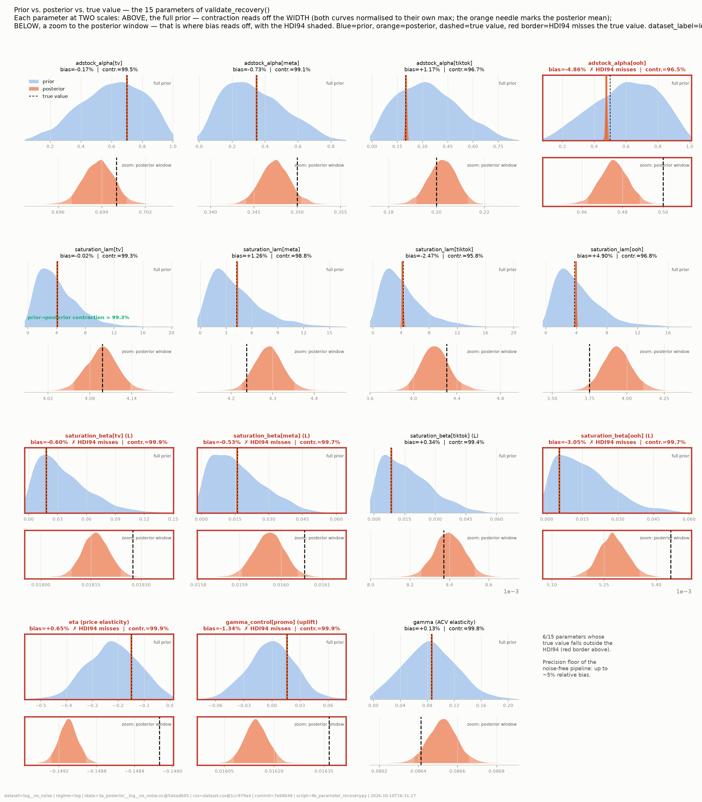
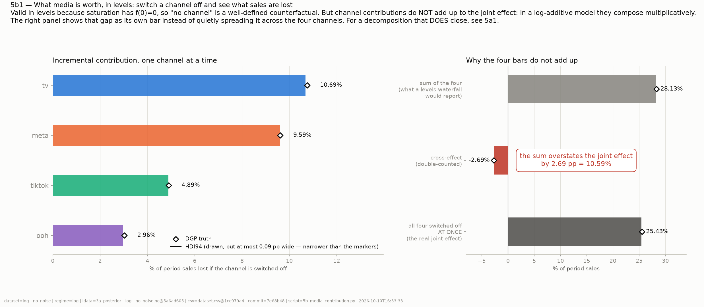
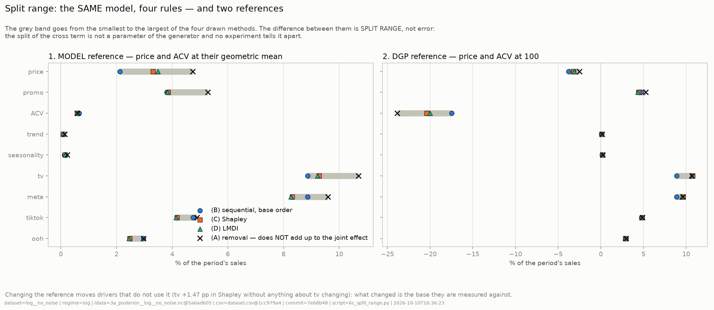
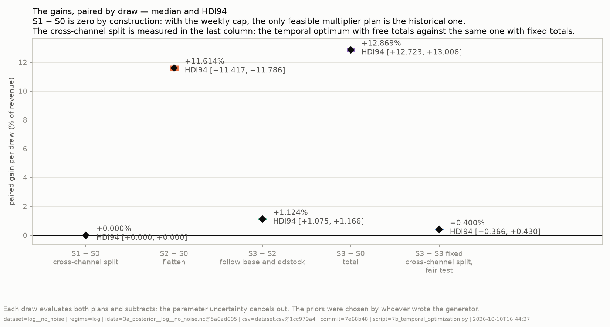

# Bayesian MMM — basic model, end to end

A complete Bayesian Marketing Mix Model on **synthetic** data, with the generator included.
Since the generator is part of the repo, the true parameters are known: every estimate can be
compared against the truth, and that is what the repo shows.

The model is multiplicative (`log(sales)` as the target, additive in logarithms) over 156 weeks of
a `Geo_Centro` · `Retail` slice, with four media channels (TV, Meta, TikTok, OOH), geometric
adstock, logistic saturation, price, promotion, distribution (ACV), linear trend and Fourier
seasonality. It is fitted with [pymc-marketing](https://www.pymc-marketing.io) 0.19.2.

This repo was built with pymc-marketing 0.19.2 (March 2026) and stays pinned to that version.

> **What this repo demonstrates and what it does not.** All the priors were chosen by whoever wrote
> the generator: two (the trend and the seasonality) come straight from it, and two others were
> revised after comparing them with the truth. That makes parameter recovery look very good, and it is
> **optimistic by construction**: the repo demonstrates the **method** and the **identifiability** of
> the model, not its precision on real data. Every number that comes out of here carries that warning
> next to it, and the tables in `results/` repeat it at the very top.

## What is inside

| Stage | What it does |
|---|---|
| `synthetic_data/` | The generator: the full DGP, with its true parameters in a JSON |
| `model/1_specification/` | The model specification: how it is built and with which prior each parameter enters |
| `model/2_priors/` | Prior predictive checks |
| `model/3_fit/` | The fit (NUTS, 4 chains) and the convergence diagnostics |
| `model/4_recovery/` | The canonical recovery function and parameter recovery |
| `model/5_business/` | Contributions, duets, ROAS and budget sweep |
| `model/6_cross_term/` | The decomposition of the cross term |
| `model/7_optimization/` | Budget optimization, across channels and over time |
| `viz/` | The shared primitives: counterfactuals, decomposition, response curves, style |
| `tests/` | Regression tests that run on their own, without pytest |
| `figures/` | Four versioned figures, to see them without running anything (see below) |
| `docs/` | The repo map by stage, generated from the code (the overall one is in [Repo map](#repo-map)) |

## Specification and priors

`log(sales)` as the target. Each channel goes through a geometric adstock of `l_max = 12` weeks: what
is spent in one week is spread between that week and the eleven following ones, with weights that decay
and **add up to 1**, so the adstock moves spend in time without making it bigger or smaller. Then it
goes through a logistic saturation.

Before fitting, pymc-marketing divides **each channel by its maximum** and the **target by its absolute
maximum**, `max|log(sales)| = 12.1509`. The priors of `saturation_beta` and `gamma_control` are
written on that divided scale, not in log-points: the table gives both. The log controls have their
mean subtracted (the columns with the `_c` suffix), and this repo does that before passing the
data to the library; the library centres nothing.

| Parameter | Prior | In log-points | Origin | Where it comes from |
|---|---|---|---|---|
| `intercept` | `HalfNormal(σ=1)` | — | observed data | the target divided by its maximum lies between 0.86 and 1; the level was justified, not the width |
| `adstock_alpha` tv, ooh | `Beta(3, 2)`, mean 0.60 | — | domain | awareness channels, with longer carryover. They were split from meta and tiktok after seeing that a common prior left the true alpha of tv in the upper tail of the prior |
| `adstock_alpha` meta, tiktok | `Beta(2, 4)`, mean 0.33 | — | domain | performance channels, with short carryover |
| `saturation_lam` | `Gamma(2, 0.471)`, shared | — | observed data | half saturation falls within the observed impressions range, computed with a generic alpha per group —0.6 for tv and ooh, 0.333 for meta and tiktok, the means of their priors— and not with the true one |
| `saturation_beta` tv | `HalfNormal(σ=0.045)` | σ = 0.547 | domain | tv tends to be the channel with the highest ceiling in consumer goods. The tv prior is 2.25× wider; the true ceiling of tv is 1.1× that of meta and 3.4× that of ooh. It was widened after seeing that with a common σ tv did not recover its value |
| `saturation_beta` meta, tiktok, ooh | `HalfNormal(σ=0.020)` | σ = 0.243 | domain | channels with a smaller individual ceiling |
| `gamma[log_price_c]` | `TruncatedNormal(μ=−0.216, σ=0.107, ≤0)` | μ = −2.62, σ = 1.30 | domain | μ is the average of 1851 price elasticities from 81 studies (Bijmolt, van Heerde & Pieters, 2005, *Journal of Marketing Research*). σ = 1.3 because in consumer goods price sensitivity is lower and varies a lot across studies: the prior goes from −4.77 to −0.71 between its 5th and 95th percentiles. The true one is −1.80 and falls at 0.6σ |
| `gamma[promo_flag]` | `Normal(μ=0, σ=0.025)`, unbounded | σ = 0.304 | domain | weakly informative and centred at zero: between its 5th and 95th percentiles it goes from −39% to +65% lift, and it allows a negative lift with probability 50%. It does not use the fact that a promotion tends to lift sales. The true one is +22% (0.199 in log), at 0.65σ |
| `gamma[log_acv_c]` | `TruncatedNormal(μ=0.082, σ=0.041, ≥0)` | μ = 1.00, σ = 0.50 | domain | more distribution, proportionally more sales (elasticity ~1); wide σ because there is no meta-analysis to back it. The true one is 1.05 |
| `gamma[t_norm_c]` | `Normal(μ=0.0097, σ=0.0123)`, unbounded | μ = 0.118, σ = 0.15 | generator | μ = log(1.125): a growth of 12.5% in three years, the same as the generator's (0.0008 per week over 156). In the generator's equation, which puts the trend inside the logarithm, the accumulated amount is log(1 + 0.0008·155) = 0.117 |
| `gamma_fourier` (2 harmonics) | `Laplace(0, b=0.0095)` | b = 0.115 | generator | the reference amplitude, 0.08, is that of the generator's seasonality |
| likelihood `σ` | `HalfNormal(σ=0.010)` | 0.122 | loose | deliberately loose prior, ~120× the noise floor of the dataset |

**Two of the twelve come from the generator: the trend and the seasonality.** Of the other ten, seven
are domain priors, two come from the observed data and one is deliberately loose. But the domain was
also chosen by whoever wrote the generator, and the tv priors of `adstock_alpha` and `saturation_beta`
were revised after comparing them with the truth. That is why recovery looks so good: the repo
demonstrates identifiability, not prior calibration. See [Limitations](#limitations).

## Install

Python 3.11. `requirements.txt` has the exact versions of the environment the numbers below were
validated with.

```bash
python -m venv venv
venv/Scripts/python -m pip install -r requirements.txt          # Windows
# source venv/bin/activate && pip install -r requirements.txt   # Linux / macOS
```

## Run end to end

Each script says in its header what it produces. They run in the order of their names: the number is the
stage and the letter, the order within it. `4a_` is the recovery function the figure scripts also use;
run on its own, it prints the recovery table of a `.nc`. The slowest are `2a_`, `2b_`, `7a_` and `7b_`
(minutes each); the rest take seconds.

```bash
# the dataset. With no arguments it asks for the configuration; this way it chooses it without asking:
python synthetic_data/generate_dataset.py --regime log --noise zero --seed 42 --stress none

# 1. specification: builds the model and prints it, without fitting anything
python model/1_specification/1a_specification.py

# 2. priors
python model/2_priors/2a_lam_prior.py
python model/2_priors/2b_prior_predictive.py

# 3. the fit (real MCMC; writes model/3_fit/3a_posterior__log__no_noise.nc and prints
#    divergences, maximum r_hat and minimum ess_bulk) and its diagnostics
python model/3_fit/3a_fit.py
python model/3_fit/3b_convergence.py
python model/3_fit/3c_posterior_geometry.py
python model/3_fit/3d_fit_over_time.py

# 4. parameter recovery, against the generator's truth
python model/4_recovery/4a_recovery_function.py model/3_fit/3a_posterior__log__no_noise.nc
python model/4_recovery/4b_parameter_recovery.py
python model/4_recovery/4c_relative_error.py
python model/4_recovery/4d_calibration.py
python model/4_recovery/4e_contraction_vs_bias.py
python model/4_recovery/4f_saturation_by_channel.py
python model/4_recovery/4g_adstock_by_channel.py
python model/4_recovery/4h_prior_curves.py

# 5. business reading
python model/5_business/5a_year_over_year.py
python model/5_business/5b_media_contribution.py
python model/5_business/5c_price_and_acv.py
python model/5_business/5d_roas.py
python model/5_business/5e_budget_sweep.py

# 6. the cross term (6c_ is cross-checked against the 6b_ table)
python model/6_cross_term/6a_cross_term.py
python model/6_cross_term/6b_cross_term_split.py
python model/6_cross_term/6c_split_range.py

# 7. budget optimization
python model/7_optimization/7a_cross_channel_optimization.py
python model/7_optimization/7b_temporal_optimization.py

# the tests run standalone, without pytest. test_decomposition.py needs the .nc from step 3;
# the other two do not depend on any fit.
python tests/test_adstock_alignment.py
python tests/test_saturation_alignment.py
python tests/test_decomposition.py
```

## Which figures it produces, and where

They go to the `plots/` folder of each stage (`model/<S>_<stage>/plots/`), which is not versioned: every run rewrites it. All of them carry
the `dataset_label` in the name except `2a1`, `2a2`, `2b1` and `2b2`. They carry a provenance footer with
the hash of the `.nc`, that of the CSV and the commit they were generated from; if the working tree is
dirty, the stamp says so. The hash of the `.nc` changes with every fit even if the posterior matches (the
sampling does not reproduce the last bit), so two runs of the same figure carry different
stamps.

| Figure | What it shows |
|---|---|
| `2a1`, `2a2` | The saturation prior: density of `lam` and the shape of the curve against the true one |
| `2b1`, `2b2` | Prior predictive: the HDI94 and HDI50 of the target, week by week, against the observed one; and the variance decomposition the priors imply. The observed series falls inside the HDI94. The prior is wide and asymmetric, so the HDI50 hugs the mode and stays below the observed series |
| `3b1` | Convergence: rank plots and energy |
| `3c1` | Posterior geometry: `adstock_alpha` × `saturation_lam` and parallel coordinates |
| `3d1` | Fit over time: observed against fitted, week by week |
| `4b1` | Prior against posterior against truth, for the 15 parameters |
| `4c1` | Forest of the relative error by parameter |
| `4d1` | Calibration: coverage of the intervals |
| `4e1` | Contraction against bias, in the four quadrants |
| `4f1` | Estimated saturation by channel, against the true one |
| `4g1` | Adstock decay by channel, against the true one |
| `4h1` | The response curves implied by the prior, channel by channel |
| `5a1` | Year-over-year duet: what explains the change from one year to the next, in log-points |
| `5b1` | Media contribution in levels, with the cross term as a separate bar |
| `5c1` | Price and ACV against their period average; each panel gives in its title the estimated elasticity, its HDI94 and the true one |
| `5d1` | Average and marginal ROAS by channel |
| `5e1` | Budget sweep from 0 to 1.5×, with the extrapolated zone marked |
| `6c1` | Split range: four decomposition rules and two references |
| `7a1` | Cross-channel optimization: historical spend against optimum, and expected sales |
| `7b1` | Weekly spend by channel: historical, flattened and temporal optimum, with the pressure of the optimum after adstock; on top, the base as index 100 and the year-end weeks |
| `7b2` | The paired gains per draw between the plans, with their HDI94, including the fair test of the cross-channel split |

Four of them are versioned in `figures/`, generated from a clean commit:









The tables go to `results/`:

| Table | What it contains |
|---|---|
| `4b_parameter_recovery__*.csv`, `4b_contraction_displacement__*.csv` | The recovery of each parameter with its HDI94, and the contraction and displacement from prior to posterior |
| `6a_cross_term__*.md` | The size of the cross term, in the model and in the generator |
| `6b_cross_term_split__*.md` | The split across drivers with four methods and two references |
| `7a_cross_channel_optimization__*.md` | The cross-channel reallocation scenario, with its control |
| `7b_temporal_optimization__*.md` | The plans over time, the fair test, their controls and the generator |

## What it gives, run end to end

On the no-noise dataset, seed 42. The numbers that move in the second or third decimal
between two fits with the same code are rounded to what repeats.

- **Parameter recovery:** the worst relative bias of the 15 parameters is **~5%, in ooh**
  (`saturation_lam` or `adstock_alpha`, depending on the fit), and the true value falls inside the HDI94 in
  **9 of 15**.
- **Convergence:** **0 divergences** in 4000 draws, maximum `r_hat` below 1.003 and
  minimum `ess_bulk` of ~1900.
- **Media overlap:** the sum of the four individual effects overstates the joint effect
  by **10.59%** in the model and **10.67%** in the generator.

"Zero noise" is not zero: sales carry a noise floor (`SIGMA_EPS_FLOOR`, in
`config/mmm_dgp_config.py`) that also comes from the seed, so `--seed` changes the dataset even
with `--noise zero`.

### With low noise

The same model on the dataset with `low` noise (target SNR 8 on sales), with three noise
seeds. The design of the dataset —flighting, price, ACV, true parameters— does not change: only
the noise realization changes.

| Seed | Truth inside the HDI94 | Max \|bias\| | Parameter that produces it |
|---|---|---|---|
| 7 | 14 of 15 | 52.80% | `adstock_alpha[tiktok]` |
| 8 | 14 of 15 | 21.66% | `saturation_beta[ooh]` |
| 9 | 15 of 15 | 76.15% | `saturation_lam[meta]` |

With noise, the intervals become honest, but the adstock and saturation parameters the
model cannot separate drift away from the truth.

```bash
# for each seed N in 7, 8 and 9. The generator rewrites the live dataset: to go back to the usual
# one, step 1 above.
python synthetic_data/generate_dataset.py --regime log --noise low --seed N --stress none
python model/3_fit/3a_fit.py
python model/4_recovery/4a_recovery_function.py model/3_fit/3a_posterior__log__low-sN.nc
```

## Two things worth looking at

**The waterfall in levels does not close, and it is not an error.** The model is additive in logarithms, so
in levels the channels compose multiplicatively: hence the 10.6% above. `5b1` draws it
as a bar of its own instead of prorating it silently, and `6b_`/`6c1` show that the split of that
excess is a **range**, not a number: four legitimate rules (removal, sequential, Shapley, LMDI)
give four different answers, and no experiment tells them apart.

**The budget optimum comes from the marginal return, not from the average ROI.** `7a_` maximizes the expected
sales of the period with the total budget fixed, checks that at the optimum the marginal returns of the
free channels are equal (~7.57 all four, against 7.1–8.7 in the historical plan), and
has a control that can fail: with a channel placed artificially on the flat zone of its
saturation, the optimum has to take budget away from it. A split in proportion to the average ROI gives
**~−1.0%**: worse than doing nothing. That optimum, mind you, takes `meta` and `ooh` above the
observed weekly maximum of impressions.

**And the big lever is in time.** `7b_` compares plans with the same budget and a weekly cap
in impressions, measured on draws that were not used to optimize. Scaling each channel by
a multiplier, like `7a_`, gives exactly the historical plan: with the weekly cap, the peak week of
each channel is already at its observed maximum, so it is an identity of the problem, not a finding.
Flattening the spend gives **+11.6%** over the historical plan and the week-by-week optimum, **+12.9%**; with the
exact equation of the generator, the same plans give +11.59% and +12.88%. The fair test of the cross-channel
split is a different one: the same temporal optimum with each channel's total fixed at its historical one gains
**+12.42%**, and with free totals, **+12.87%**. Reallocating across channels adds **+0.40%** (HDI94
+0.37% to +0.43%) once the spend already moves over time: small next to moving spend across
weeks, but not zero.

The optimum is not even pacing: it correlates **+0.76** with the base `Y_t` without media, because in a
multiplicative model the same impression yields more where the base is already high. But it does not follow the base alone:
`tv` is switched off for 26 weeks, 15 of them at year end, where its CPM is 1.21× above its mean, and
in three of those weeks there is a promotion and the base is high. With the base, the price and the CPM forced to be
constant it does come out as even pacing (CV 0.0021), which is the control that proves there is no bug.

The flighting of this dataset is **deliberate**: it is there so that the saturation curve is
identifiable, so the gain from flattening measures that design and not a real media plan.

<!-- MAP: start. Generated automatically from the code; do not edit by hand. -->
## Repo map

> Generated automatically from the repo's code: the imports, the calls that read and write files, and `config/`. It is not edited by hand: it is generated by a script in the author's working repo, which is not included in this repo.

What runs, what each thing reads and where every number comes from. The detail diagrams, one per stage, and the parameter table are in [docs/MAP.md](docs/MAP.md).

- **Green rounded box** = hand-written input: `config/` with parameters, or versioned data a process reads. **Bullets without a box** = its parameters, *business name (technical name)*; `← X` = derived from X.
- **Blue rounded box** = process. `uses:` = the parameters the script names itself, and the ones it reaches through the config functions it calls (`fit_priors() → …`); `via modules:` = what each module it imports contributes. **Red box** = output: square if it ends there, rounded if another process reads it; `(from …)` = another stage produces it.
- **Green arrow** = comes out of an input or parameter; labelled `A → B` = parameter B is derived from A. **Red arrow** = from a process to what it produces, or from an output to whoever reads it; its label says what it is read for, or which processes of the stage take part when not all of them do.
- **Dotted brown box with ⚠** = a problem, linked only to where it applies. **Grey hexagon** = a control (`warn_if_idata_stale`, `check_prior_scale`) and the processes that use it.
- **Limits:** classifying each loose number as cosmetic or trivial is manual (a marker on its line); numbers inside a text are not detected; a versioned copy of an output is recognized because it has the same file name; `via modules:` counts everything each imported module uses, even if the process does not call that function.

```mermaid
flowchart LR
    nconfig_budget_py("config/budget.py")
    nconfig_compilation_py("config/compilation.py")
    nconfig_dgp_axes_py("config/dgp_axes.py")
    nconfig_diagnostics_py("config/diagnostics.py")
    nconfig_log_regime_py("config/log_regime.py")
    nconfig_mmm_dgp_config_py("config/mmm_dgp_config.py")
    nconfig_prior_checks_py("config/prior_checks.py")
    nsynthetic_data_regimes_log__no_noise_dataset_csv("synthetic_data/regimes/log__no_noise/dataset.csv<br/>(versioned data)")
    gnmodel_1_specification("<b>model/1_specification</b><br/>1a_specification.py")
    gnmodel_2_priors("<b>model/2_priors</b><br/>2a_lam_prior.py, 2b_prior_predictive.py")
    gnmodel_3_fit("<b>model/3_fit</b><br/>3a_fit.py, 3b_convergence.py, 3c_posterior_geometry.py, 3d_fit_over_time.py")
    gnmodel_4_recovery("<b>model/4_recovery</b> · detail in 2 parts<br/>4a_recovery_function.py, 4b_parameter_recovery.py, 4c_relative_error.py, 4d_calibration.py, 4e_contraction_vs_bias.py, 4f_saturation_by_channel.py, 4g_adstock_by_channel.py, 4h_prior_curves.py")
    gnmodel_5_business("<b>model/5_business</b><br/>5a_year_over_year.py, 5b_media_contribution.py, 5c_price_and_acv.py, 5d_roas.py, 5e_budget_sweep.py")
    gnmodel_6_cross_term("<b>model/6_cross_term</b><br/>6a_cross_term.py, 6b_cross_term_split.py, 6c_split_range.py")
    gnmodel_7_optimization("<b>model/7_optimization</b><br/>7a_cross_channel_optimization.py, 7b_temporal_optimization.py")
    gnsynthetic_data("<b>synthetic_data</b><br/>generate_dataset.py")
    gntests("<b>tests</b><br/>test_adstock_alignment.py, test_decomposition.py, test_saturation_alignment.py")
    nmodel_3_fit_3a_posterior____nc("model/3_fit/3a_posterior__&lt;label&gt;.nc<br/>(model/3_fit)")
    nresults_6b_cross_term_split____md("results/6b_cross_term_split__&lt;label&gt;.md<br/>(model/6_cross_term)")
    nsynthetic_data_dataset_csv("synthetic_data/dataset.csv<br/>(synthetic_data)")
    nsynthetic_data_true_parameters_json("synthetic_data/true_parameters.json<br/>(synthetic_data)")
    aggcsv["tables .csv"]
    aggmd["tables .md"]
    aggpng["figures .png"]
    aggsha256["sha256"]
    nconfig_budget_py --> gnmodel_5_business
    nconfig_budget_py --> gnmodel_6_cross_term
    nconfig_budget_py --> gnmodel_7_optimization
    nconfig_budget_py -->|test_decomposition| gntests
    nconfig_compilation_py -->|3a_| gnmodel_3_fit
    nconfig_dgp_axes_py --> gnsynthetic_data
    nconfig_diagnostics_py --> gnmodel_1_specification
    nconfig_diagnostics_py --> gnmodel_2_priors
    nconfig_diagnostics_py -->|3a_| gnmodel_3_fit
    nconfig_diagnostics_py --> gnmodel_4_recovery
    nconfig_diagnostics_py -->|6b_, 6c_| gnmodel_6_cross_term
    nconfig_log_regime_py --> gnmodel_1_specification
    nconfig_log_regime_py --> gnmodel_2_priors
    nconfig_log_regime_py --> gnmodel_3_fit
    nconfig_log_regime_py --> gnmodel_4_recovery
    nconfig_log_regime_py --> gnmodel_5_business
    nconfig_log_regime_py --> gnmodel_6_cross_term
    nconfig_log_regime_py --> gnmodel_7_optimization
    nconfig_log_regime_py --> gnsynthetic_data
    nconfig_log_regime_py -->|test_decomposition, test_saturation_alignment| gntests
    nconfig_mmm_dgp_config_py -->|L_MAX → CARRYOVER_TAIL| nconfig_budget_py
    nconfig_mmm_dgp_config_py -->|MEDIA_CHANNELS → NOISY_VARIABLES| nconfig_dgp_axes_py
    nconfig_mmm_dgp_config_py --> gnmodel_1_specification
    nconfig_mmm_dgp_config_py --> gnmodel_2_priors
    nconfig_mmm_dgp_config_py --> gnmodel_3_fit
    nconfig_mmm_dgp_config_py --> gnmodel_4_recovery
    nconfig_mmm_dgp_config_py --> gnmodel_5_business
    nconfig_mmm_dgp_config_py --> gnmodel_6_cross_term
    nconfig_mmm_dgp_config_py --> gnmodel_7_optimization
    nconfig_mmm_dgp_config_py --> gnsynthetic_data
    nconfig_mmm_dgp_config_py --> gntests
    nconfig_prior_checks_py -->|2a_| gnmodel_2_priors
    nsynthetic_data_regimes_log__no_noise_dataset_csv --> gnmodel_1_specification
    nsynthetic_data_regimes_log__no_noise_dataset_csv -->|2b_| gnmodel_2_priors
    nsynthetic_data_regimes_log__no_noise_dataset_csv -->|3a_| gnmodel_3_fit
    nsynthetic_data_regimes_log__no_noise_dataset_csv -->|4b_, 4e_, 4h_| gnmodel_4_recovery
    gnmodel_2_priors --> aggpng
    gnmodel_3_fit -->|3a_| nmodel_3_fit_3a_posterior____nc
    gnmodel_3_fit -->|3b_, 3c_, 3d_| aggpng
    gnmodel_3_fit -->|3a_| aggsha256
    gnmodel_4_recovery -->|4b_| aggcsv
    gnmodel_4_recovery -->|4b_, 4c_, 4d_, 4e_, 4f_, 4g_, 4h_| aggpng
    gnmodel_5_business --> aggpng
    gnmodel_6_cross_term -->|6b_| nresults_6b_cross_term_split____md
    gnmodel_6_cross_term -->|6a_| aggmd
    gnmodel_6_cross_term -->|6c_| aggpng
    gnmodel_7_optimization --> aggmd
    gnmodel_7_optimization --> aggpng
    gnsynthetic_data --> nsynthetic_data_dataset_csv
    gnsynthetic_data --> nsynthetic_data_true_parameters_json
    gnsynthetic_data --> aggcsv
    gnsynthetic_data --> aggmd
    nmodel_3_fit_3a_posterior____nc -->|3b_, 3c_, 3d_| gnmodel_3_fit
    nmodel_3_fit_3a_posterior____nc --> gnmodel_4_recovery
    nmodel_3_fit_3a_posterior____nc --> gnmodel_5_business
    nmodel_3_fit_3a_posterior____nc --> gnmodel_6_cross_term
    nmodel_3_fit_3a_posterior____nc --> gnmodel_7_optimization
    nmodel_3_fit_3a_posterior____nc -->|test_decomposition| gntests
    nresults_6b_cross_term_split____md -->|6c_| gnmodel_6_cross_term
    nsynthetic_data_dataset_csv --> gnmodel_1_specification
    nsynthetic_data_dataset_csv --> gnmodel_2_priors
    nsynthetic_data_dataset_csv -->|3a_| gnmodel_3_fit
    nsynthetic_data_dataset_csv -->|4b_, 4e_, 4f_, 4h_| gnmodel_4_recovery
    nsynthetic_data_dataset_csv --> gnmodel_5_business
    nsynthetic_data_dataset_csv --> gnmodel_6_cross_term
    nsynthetic_data_dataset_csv --> gnmodel_7_optimization
    nsynthetic_data_dataset_csv -->|test_decomposition| gntests
    nsynthetic_data_true_parameters_json --> gnmodel_1_specification
    nsynthetic_data_true_parameters_json --> gnmodel_2_priors
    nsynthetic_data_true_parameters_json --> gnmodel_3_fit
    nsynthetic_data_true_parameters_json --> gnmodel_4_recovery
    nsynthetic_data_true_parameters_json --> gnmodel_5_business
    nsynthetic_data_true_parameters_json --> gnmodel_6_cross_term
    nsynthetic_data_true_parameters_json --> gnmodel_7_optimization
    nsynthetic_data_true_parameters_json -->|test_decomposition| gntests

    classDef param fill:none,stroke:none,color:#333,text-align:left
    classDef alerta fill:#fff8ec,stroke:#9a5b00,stroke-width:1px,stroke-dasharray:4 3,color:#9a5b00,text-align:left
    classDef control fill:#f4f4f4,stroke:#6b6b6b,stroke-width:1px,color:#333
    classDef input fill:#ffffff,stroke:#2e9e3f,stroke-width:3px,color:#1b3d1b
    classDef proceso fill:#ffffff,stroke:#2d3fbf,stroke-width:3px,color:#0d1a57
    classDef output fill:#ffffff,stroke:#e02020,stroke-width:3px,color:#5a1010
    class nconfig_budget_py input
    class nconfig_compilation_py input
    class nconfig_dgp_axes_py input
    class nconfig_diagnostics_py input
    class nconfig_log_regime_py input
    class nconfig_mmm_dgp_config_py input
    class nconfig_prior_checks_py input
    class nsynthetic_data_regimes_log__no_noise_dataset_csv input
    class gnmodel_1_specification proceso
    class gnmodel_2_priors proceso
    class gnmodel_3_fit proceso
    class gnmodel_4_recovery proceso
    class gnmodel_5_business proceso
    class gnmodel_6_cross_term proceso
    class gnmodel_7_optimization proceso
    class gnsynthetic_data proceso
    class gntests proceso
    class nmodel_3_fit_3a_posterior____nc output
    class nresults_6b_cross_term_split____md output
    class nsynthetic_data_dataset_csv output
    class nsynthetic_data_true_parameters_json output
    class aggcsv output
    class aggmd output
    class aggpng output
    class aggsha256 output
    linkStyle 0 stroke:#2e9e3f,stroke-width:3px
    linkStyle 1 stroke:#2e9e3f,stroke-width:3px
    linkStyle 2 stroke:#2e9e3f,stroke-width:3px
    linkStyle 3 stroke:#2e9e3f,stroke-width:3px
    linkStyle 4 stroke:#2e9e3f,stroke-width:3px
    linkStyle 5 stroke:#2e9e3f,stroke-width:3px
    linkStyle 6 stroke:#2e9e3f,stroke-width:3px
    linkStyle 7 stroke:#2e9e3f,stroke-width:3px
    linkStyle 8 stroke:#2e9e3f,stroke-width:3px
    linkStyle 9 stroke:#2e9e3f,stroke-width:3px
    linkStyle 10 stroke:#2e9e3f,stroke-width:3px
    linkStyle 11 stroke:#2e9e3f,stroke-width:3px
    linkStyle 12 stroke:#2e9e3f,stroke-width:3px
    linkStyle 13 stroke:#2e9e3f,stroke-width:3px
    linkStyle 14 stroke:#2e9e3f,stroke-width:3px
    linkStyle 15 stroke:#2e9e3f,stroke-width:3px
    linkStyle 16 stroke:#2e9e3f,stroke-width:3px
    linkStyle 17 stroke:#2e9e3f,stroke-width:3px
    linkStyle 18 stroke:#2e9e3f,stroke-width:3px
    linkStyle 19 stroke:#2e9e3f,stroke-width:3px
    linkStyle 20 stroke:#2e9e3f,stroke-width:3px
    linkStyle 21 stroke:#2e9e3f,stroke-width:3px
    linkStyle 22 stroke:#2e9e3f,stroke-width:3px
    linkStyle 23 stroke:#2e9e3f,stroke-width:3px
    linkStyle 24 stroke:#2e9e3f,stroke-width:3px
    linkStyle 25 stroke:#2e9e3f,stroke-width:3px
    linkStyle 26 stroke:#2e9e3f,stroke-width:3px
    linkStyle 27 stroke:#2e9e3f,stroke-width:3px
    linkStyle 28 stroke:#2e9e3f,stroke-width:3px
    linkStyle 29 stroke:#2e9e3f,stroke-width:3px
    linkStyle 30 stroke:#2e9e3f,stroke-width:3px
    linkStyle 31 stroke:#2e9e3f,stroke-width:3px
    linkStyle 32 stroke:#2e9e3f,stroke-width:3px
    linkStyle 33 stroke:#2e9e3f,stroke-width:3px
    linkStyle 34 stroke:#2e9e3f,stroke-width:3px
    linkStyle 35 stroke:#2e9e3f,stroke-width:3px
    linkStyle 36 stroke:#e02020,stroke-width:3px
    linkStyle 37 stroke:#e02020,stroke-width:3px
    linkStyle 38 stroke:#e02020,stroke-width:3px
    linkStyle 39 stroke:#e02020,stroke-width:3px
    linkStyle 40 stroke:#e02020,stroke-width:3px
    linkStyle 41 stroke:#e02020,stroke-width:3px
    linkStyle 42 stroke:#e02020,stroke-width:3px
    linkStyle 43 stroke:#e02020,stroke-width:3px
    linkStyle 44 stroke:#e02020,stroke-width:3px
    linkStyle 45 stroke:#e02020,stroke-width:3px
    linkStyle 46 stroke:#e02020,stroke-width:3px
    linkStyle 47 stroke:#e02020,stroke-width:3px
    linkStyle 48 stroke:#e02020,stroke-width:3px
    linkStyle 49 stroke:#e02020,stroke-width:3px
    linkStyle 50 stroke:#e02020,stroke-width:3px
    linkStyle 51 stroke:#e02020,stroke-width:3px
    linkStyle 52 stroke:#e02020,stroke-width:3px
    linkStyle 53 stroke:#e02020,stroke-width:3px
    linkStyle 54 stroke:#e02020,stroke-width:3px
    linkStyle 55 stroke:#e02020,stroke-width:3px
    linkStyle 56 stroke:#e02020,stroke-width:3px
    linkStyle 57 stroke:#e02020,stroke-width:3px
    linkStyle 58 stroke:#e02020,stroke-width:3px
    linkStyle 59 stroke:#e02020,stroke-width:3px
    linkStyle 60 stroke:#e02020,stroke-width:3px
    linkStyle 61 stroke:#e02020,stroke-width:3px
    linkStyle 62 stroke:#e02020,stroke-width:3px
    linkStyle 63 stroke:#e02020,stroke-width:3px
    linkStyle 64 stroke:#e02020,stroke-width:3px
    linkStyle 65 stroke:#e02020,stroke-width:3px
    linkStyle 66 stroke:#e02020,stroke-width:3px
    linkStyle 67 stroke:#e02020,stroke-width:3px
    linkStyle 68 stroke:#e02020,stroke-width:3px
    linkStyle 69 stroke:#e02020,stroke-width:3px
    linkStyle 70 stroke:#e02020,stroke-width:3px
    linkStyle 71 stroke:#e02020,stroke-width:3px
    linkStyle 72 stroke:#e02020,stroke-width:3px
    linkStyle 73 stroke:#e02020,stroke-width:3px
    linkStyle 74 stroke:#e02020,stroke-width:3px
```


<!-- MAP: end -->

## Limitations

**Almost everything is measured on the no-noise dataset.** The measured SNR of the canonical slice is **339.7** (it is
in `metadata.measured_snr` of the truth JSON): there is practically no observation noise. A bias of
~5% measured against data like that says nothing about what would happen with real data. With low noise only
coverage and bias are reported, above; the figures and tables are from the no-noise dataset. The
generator also accepts `--noise medium|high|very_high`, but this repo does not report those fits.

**The truth falls outside the HDI94 in 6 of 15 parameters.** The true value falls inside the HDI94 in
9 of 15 parameters: the posterior is **overconfident**. One hypothesis, which I do not claim as fact, is
a shape mismatch: the generator puts the trend **inside** the logarithm
(`log(1 + seasonality + 0.0008·t)`) and the model approximates it from outside, with a linear term plus
two Fourier harmonics; that difference can push bias towards the correlated parameters.
And there is a limit of method: **15 parameters from a single fit are not 15 independent trials**, so
"9 of 15" is not a coverage rate in the frequentist sense. Measuring it properly calls for simulation
based calibration —many datasets, one per prior draw—, which this repo does not do.

**The functional form conditions part of the optimization result.** `LogisticSaturation` is
a `tanh`, concave from the origin: splitting the same spend between two weeks always yields at least
as much as concentrating it. The `tanh` pushes towards splitting, and that is why the model cannot recommend
pulsing even if the data asked for it. That does not guarantee that flattening is optimal: the model is
multiplicative and the base changes week by week, so the optimum tends to follow the base
(correlation **+0.76** between the optimal spend and the base, the one `7b_` prints), except where the CPM
rules. The **+11.6%** from flattening measures,
then, two things at once: the deliberate flighting of the dataset and the concavity the estimator
assumes. Separating them calls for an estimator with S-shaped saturation (with a convex zone at the start),
which this repo does not have.

## License

MIT — see [LICENSE](LICENSE).
