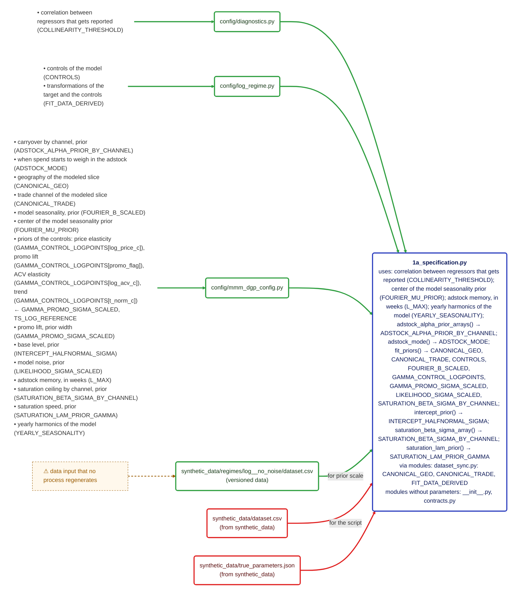
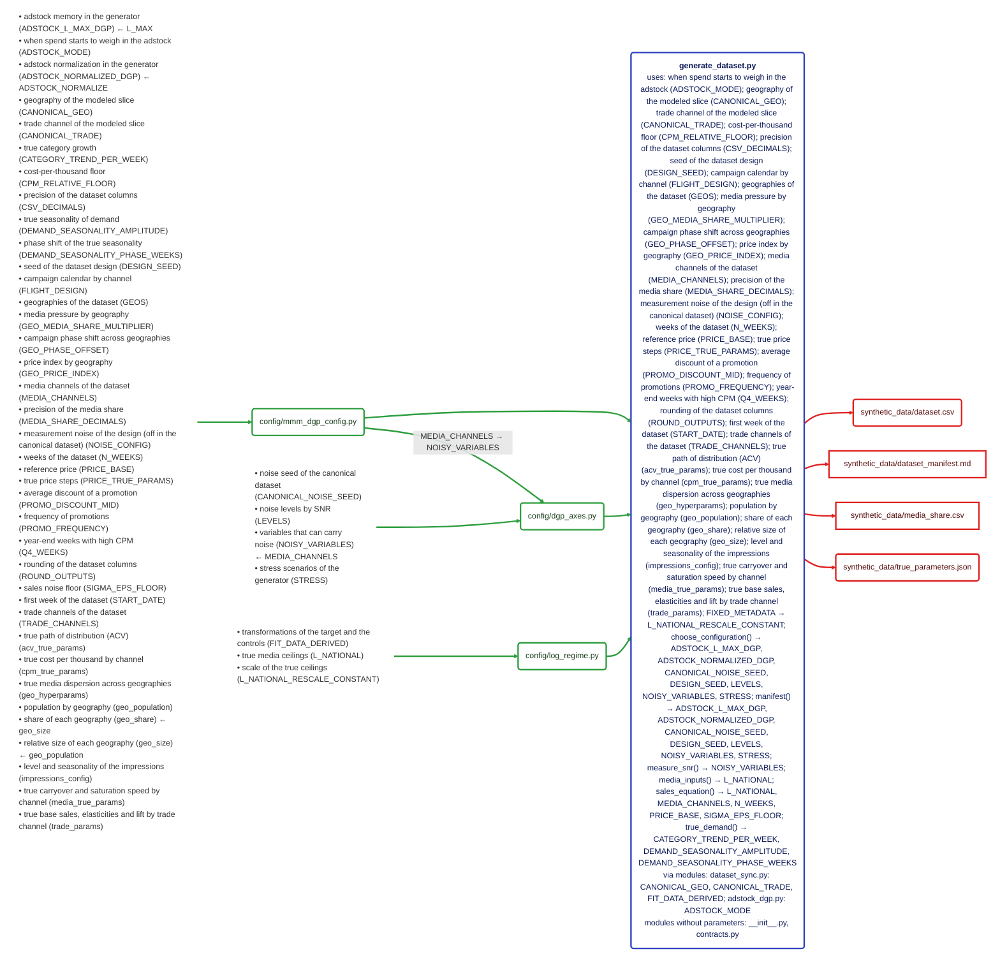
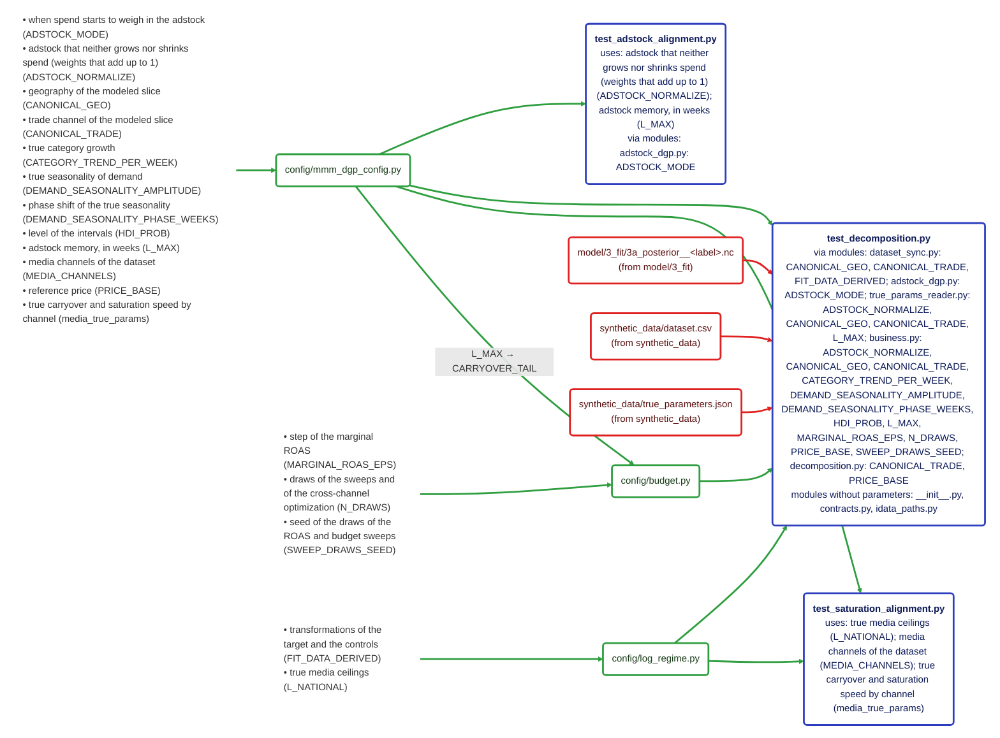

# Repo map — detail by stage

> Generated automatically from the repo's code: the imports, the calls that read and write files, and `config/`. It is not edited by hand: it is generated by a script in the author's working repo, which is not included in this repo.

The overall diagram is in the [README](../README.md#repo-map).

## Legend

- **Green rounded box** = hand-written input: `config/` with parameters, or versioned data a process reads. **Bullets without a box** = its parameters, *business name (technical name)*; `← X` = derived from X.
- **Blue rounded box** = process. `uses:` = the parameters the script names itself, and the ones it reaches through the config functions it calls (`fit_priors() → …`); `via modules:` = what each module it imports contributes. **Red box** = output: square if it ends there, rounded if another process reads it; `(from …)` = another stage produces it.
- **Green arrow** = comes out of an input or parameter; labelled `A → B` = parameter B is derived from A. **Red arrow** = from a process to what it produces, or from an output to whoever reads it; its label says what it is read for, or which processes of the stage take part when not all of them do.
- **Dotted brown box with ⚠** = a problem, linked only to where it applies. **Grey hexagon** = a control (`warn_if_idata_stale`, `check_prior_scale`) and the processes that use it.
- **Limits:** classifying each loose number as cosmetic or trivial is manual (a marker on its line); numbers inside a text are not detected; a versioned copy of an output is recognized because it has the same file name; `via modules:` counts everything each imported module uses, even if the process does not call that function.

| Diagram | Nodes |
|---|---|
| model/1_specification | 11 |
| model/2_priors | 19 |
| model/3_fit | 23 |
| model/4_recovery (1/2) | 24 |
| model/4_recovery (2/2) | 19 |
| model/5_business | 20 |
| model/6_cross_term | 18 |
| model/7_optimization | 17 |
| synthetic_data | 11 |
| tests | 12 |

## config/ parameters

| Parameter | What it is | Derived from | Named directly by |
|---|---|---|---|
| `ACTIVE_EXPOSURE_THRESHOLD` (config/prior_checks.py) | which weeks count as active exposure (ACTIVE_EXPOSURE_THRESHOLD) | — | 2a_lam_prior.py |
| `ACTIVE_RANGE_PERCENTILES` (config/prior_checks.py) | exposure range where half saturation falls (ACTIVE_RANGE_PERCENTILES) | — | 2a_lam_prior.py |
| `ADSTOCK_ALPHA_PRIOR_BY_CHANNEL` (config/mmm_dgp_config.py) | carryover by channel, prior (ADSTOCK_ALPHA_PRIOR_BY_CHANNEL) | — | 2a_lam_prior.py |
| `ADSTOCK_L_MAX_DGP` (config/mmm_dgp_config.py) | adstock memory in the generator (ADSTOCK_L_MAX_DGP) | L_MAX | — |
| `ADSTOCK_MODE` (config/mmm_dgp_config.py) | when spend starts to weigh in the adstock (ADSTOCK_MODE) | — | generate_dataset.py |
| `ADSTOCK_NORMALIZE` (config/mmm_dgp_config.py) | adstock that neither grows nor shrinks spend (weights that add up to 1) (ADSTOCK_NORMALIZE) | — | 2a_lam_prior.py, 4f_saturation_by_channel.py, 4h_prior_curves.py, test_adstock_alignment.py |
| `ADSTOCK_NORMALIZED_DGP` (config/mmm_dgp_config.py) | adstock normalization in the generator (ADSTOCK_NORMALIZED_DGP) | ADSTOCK_NORMALIZE | — |
| `BUDGET` (config/budget.py) | total budget being split (BUDGET) | — | 7a_cross_channel_optimization.py |
| `CANONICAL_GEO` (config/mmm_dgp_config.py) | geography of the modeled slice (CANONICAL_GEO) | — | 4a_recovery_function.py, generate_dataset.py |
| `CANONICAL_NOISE_SEED` (config/dgp_axes.py) | noise seed of the canonical dataset (CANONICAL_NOISE_SEED) | — | — |
| `CANONICAL_TRADE` (config/mmm_dgp_config.py) | trade channel of the modeled slice (CANONICAL_TRADE) | — | 4a_recovery_function.py, 5c_price_and_acv.py, generate_dataset.py |
| `CARRYOVER_TAIL` (config/budget.py) | tail weeks to collect the carryover (CARRYOVER_TAIL) | L_MAX | 7b_temporal_optimization.py |
| `CATEGORY_TREND_PER_WEEK` (config/mmm_dgp_config.py) | true category growth (CATEGORY_TREND_PER_WEEK) | — | 4b_parameter_recovery.py |
| `COLLINEARITY_THRESHOLD` (config/diagnostics.py) | correlation between regressors that gets reported (COLLINEARITY_THRESHOLD) | — | 1a_specification.py |
| `CONTROLS` (config/log_regime.py) | controls of the model (CONTROLS) | — | 3a_fit.py, 4a_recovery_function.py |
| `CONTROL_CV_MAX` (config/budget.py) | threshold of the even-pacing check (CONTROL_CV_MAX) | — | 7b_temporal_optimization.py |
| `CONTROL_FACTOR` (config/budget.py) | how much that channel is saturated in the check (CONTROL_FACTOR) | — | 7a_cross_channel_optimization.py |
| `CPM_RELATIVE_FLOOR` (config/mmm_dgp_config.py) | cost-per-thousand floor (CPM_RELATIVE_FLOOR) | — | generate_dataset.py |
| `CROSS_CHANNEL_OPTIM` (config/budget.py) | iterations and tolerance of the cross-channel optimization (CROSS_CHANNEL_OPTIM) | — | — |
| `CSV_DECIMALS` (config/mmm_dgp_config.py) | precision of the dataset columns (CSV_DECIMALS) | — | generate_dataset.py |
| `DEMAND_SEASONALITY_AMPLITUDE` (config/mmm_dgp_config.py) | true seasonality of demand (DEMAND_SEASONALITY_AMPLITUDE) | — | — |
| `DEMAND_SEASONALITY_PHASE_WEEKS` (config/mmm_dgp_config.py) | phase shift of the true seasonality (DEMAND_SEASONALITY_PHASE_WEEKS) | — | — |
| `DESIGN_SEED` (config/mmm_dgp_config.py) | seed of the dataset design (DESIGN_SEED) | — | generate_dataset.py |
| `EDGE_VERDICT_THRESHOLDS` (config/budget.py) | December ratios read as emptied or evened out (EDGE_VERDICT_THRESHOLDS) | — | 7b_temporal_optimization.py |
| `ESS_BULK_THRESHOLD` (config/diagnostics.py) | minimum effective sample size (ESS_BULK_THRESHOLD) | — | 3a_fit.py |
| `FIGURE_SUBSAMPLE_SEED` (config/diagnostics.py) | seed of the draws that draw the bands (FIGURE_SUBSAMPLE_SEED) | — | 4f_saturation_by_channel.py, 4g_adstock_by_channel.py, 4h_prior_curves.py |
| `FIT_DATA_DERIVED` (config/log_regime.py) | transformations of the target and the controls (FIT_DATA_DERIVED) | — | — |
| `FLIGHT_DESIGN` (config/mmm_dgp_config.py) | campaign calendar by channel (FLIGHT_DESIGN) | — | generate_dataset.py |
| `FOREST_ERROR_THRESHOLD` (config/diagnostics.py) | relative error flagged in the forest (FOREST_ERROR_THRESHOLD) | — | 4a_recovery_function.py |
| `FOURIER_B_LOGPOINTS` (config/mmm_dgp_config.py) | model seasonality, prior in log-points (FOURIER_B_LOGPOINTS) | FOURIER_B_SCALED, TS_LOG_REFERENCE | — |
| `FOURIER_B_SCALED` (config/mmm_dgp_config.py) | model seasonality, prior (FOURIER_B_SCALED) | — | — |
| `FOURIER_MU_PRIOR` (config/mmm_dgp_config.py) | center of the model seasonality prior (FOURIER_MU_PRIOR) | — | 1a_specification.py, 2b_prior_predictive.py, 3a_fit.py, 4b_parameter_recovery.py, 4e_contraction_vs_bias.py, 4h_prior_curves.py |
| `FTOL_MULTIPLIERS` (config/budget.py) | tolerance of the multiplier optimizer (FTOL_MULTIPLIERS) | — | — |
| `FTOL_TEMPORAL` (config/budget.py) | tolerance of the temporal optimizer (FTOL_TEMPORAL) | — | — |
| `GAMMA_CONTROL_LOGPOINTS` (config/mmm_dgp_config.py) | priors of the controls: price elasticity (GAMMA_CONTROL_LOGPOINTS[log_price_c]), promo lift (GAMMA_CONTROL_LOGPOINTS[promo_flag]), ACV elasticity (GAMMA_CONTROL_LOGPOINTS[log_acv_c]), trend (GAMMA_CONTROL_LOGPOINTS[t_norm_c]) | GAMMA_PROMO_SIGMA_SCALED, TS_LOG_REFERENCE | — |
| `GAMMA_PROMO_SIGMA_SCALED` (config/mmm_dgp_config.py) | promo lift, prior width (GAMMA_PROMO_SIGMA_SCALED) | — | — |
| `GEOS` (config/mmm_dgp_config.py) | geographies of the dataset (GEOS) | — | generate_dataset.py |
| `GEO_MEDIA_SHARE_MULTIPLIER` (config/mmm_dgp_config.py) | media pressure by geography (GEO_MEDIA_SHARE_MULTIPLIER) | — | generate_dataset.py |
| `GEO_PHASE_OFFSET` (config/mmm_dgp_config.py) | campaign phase shift across geographies (GEO_PHASE_OFFSET) | — | generate_dataset.py |
| `GEO_PRICE_INDEX` (config/mmm_dgp_config.py) | price index by geography (GEO_PRICE_INDEX) | — | generate_dataset.py |
| `HDI_PROB` (config/mmm_dgp_config.py) | level of the intervals (HDI_PROB) | — | 3d_fit_over_time.py, 4a_recovery_function.py, 4b_parameter_recovery.py, 5b_media_contribution.py, 5c_price_and_acv.py, 5d_roas.py, 5e_budget_sweep.py, 7a_cross_channel_optimization.py, 7b_temporal_optimization.py |
| `INFORMED_CONTRACTION_THRESHOLD` (config/diagnostics.py) | minimum contraction to say the data informed (INFORMED_CONTRACTION_THRESHOLD) | — | 4b_parameter_recovery.py |
| `INFORMED_DISPLACEMENT_THRESHOLD` (config/diagnostics.py) | minimum displacement to say the data informed (INFORMED_DISPLACEMENT_THRESHOLD) | — | 4b_parameter_recovery.py |
| `INTERCEPT_HALFNORMAL_SIGMA` (config/mmm_dgp_config.py) | base level, prior (INTERCEPT_HALFNORMAL_SIGMA) | — | — |
| `KKT_THRESHOLD` (config/budget.py) | maximum dispersion of the marginals at the optimum (KKT_THRESHOLD) | — | 7a_cross_channel_optimization.py |
| `LAM_CHECK_BETA_SIGMA` (config/prior_checks.py) | saturation ceiling, prior of the saturation check (LAM_CHECK_BETA_SIGMA) | — | 2a_lam_prior.py |
| `LAM_PRIOR_DEFAULT_PYMC` (config/prior_checks.py) | saturation speed, pymc-marketing default prior (LAM_PRIOR_DEFAULT_PYMC) | — | 2a_lam_prior.py |
| `LEVELS` (config/dgp_axes.py) | noise levels by SNR (LEVELS) | — | — |
| `LIKELIHOOD_SIGMA_LOGPOINTS` (config/mmm_dgp_config.py) | model noise, prior in log-points (LIKELIHOOD_SIGMA_LOGPOINTS) | LIKELIHOOD_SIGMA_SCALED, TS_LOG_REFERENCE | — |
| `LIKELIHOOD_SIGMA_SCALED` (config/mmm_dgp_config.py) | model noise, prior (LIKELIHOOD_SIGMA_SCALED) | — | — |
| `LOWER_BOUND` (config/budget.py) | spend floor by channel (LOWER_BOUND) | — | 7a_cross_channel_optimization.py, 7b_temporal_optimization.py |
| `LOW_LAM_QUANTILE` (config/prior_checks.py) | quantile of the derived prior for the lowest lam (LOW_LAM_QUANTILE) | — | 2a_lam_prior.py |
| `L_MAX` (config/mmm_dgp_config.py) | adstock memory, in weeks (L_MAX) | — | 1a_specification.py, 2a_lam_prior.py, 2b_prior_predictive.py, 3a_fit.py, 4b_parameter_recovery.py, 4e_contraction_vs_bias.py, 4f_saturation_by_channel.py, 4g_adstock_by_channel.py, 4h_prior_curves.py, 7b_temporal_optimization.py, test_adstock_alignment.py |
| `L_NATIONAL` (config/log_regime.py) | true media ceilings (L_NATIONAL) | — | test_saturation_alignment.py |
| `L_NATIONAL_RESCALE_CONSTANT` (config/log_regime.py) | scale of the true ceilings (L_NATIONAL_RESCALE_CONSTANT) | — | — |
| `MARGINAL_ROAS_EPS` (config/budget.py) | step of the marginal ROAS (MARGINAL_ROAS_EPS) | — | — |
| `MAXITER_MULTIPLIERS` (config/budget.py) | iterations of the multiplier optimizer (MAXITER_MULTIPLIERS) | — | — |
| `MAXITER_TEMPORAL` (config/budget.py) | iterations of the temporal optimizer (MAXITER_TEMPORAL) | — | 7b_temporal_optimization.py |
| `MAX_FIT_TIME_MIN` (config/diagnostics.py) | maximum accepted fit time (MAX_FIT_TIME_MIN) | — | 3a_fit.py |
| `MEDIA_CHANNELS` (config/mmm_dgp_config.py) | media channels of the dataset (MEDIA_CHANNELS) | — | generate_dataset.py, test_saturation_alignment.py |
| `MEDIA_SHARE_DECIMALS` (config/mmm_dgp_config.py) | precision of the media share (MEDIA_SHARE_DECIMALS) | — | generate_dataset.py |
| `NOISE_CONFIG` (config/mmm_dgp_config.py) | measurement noise of the design (off in the canonical dataset) (NOISE_CONFIG) | — | generate_dataset.py |
| `NOISY_VARIABLES` (config/dgp_axes.py) | variables that can carry noise (NOISY_VARIABLES) | MEDIA_CHANNELS | — |
| `NUMBA_KWARGS` (config/compilation.py) | compilation mode of the sampling (NUMBA_KWARGS) | — | 3a_fit.py |
| `N_DRAWS` (config/budget.py) | draws of the sweeps and of the cross-channel optimization (N_DRAWS) | — | 5d_roas.py, 5e_budget_sweep.py, 7a_cross_channel_optimization.py, 7b_temporal_optimization.py |
| `N_DRAWS_BANDS` (config/diagnostics.py) | draws that make up the curve bands (N_DRAWS_BANDS) | — | 4f_saturation_by_channel.py, 4g_adstock_by_channel.py, 4h_prior_curves.py |
| `N_DRAWS_EVALUATION` (config/budget.py) | draws the temporal plan is evaluated with (N_DRAWS_EVALUATION) | — | 7b_temporal_optimization.py |
| `N_DRAWS_OPTIMIZATION` (config/budget.py) | draws the temporal plan is optimized with (N_DRAWS_OPTIMIZATION) | — | 7b_temporal_optimization.py |
| `N_PRIOR_SAMPLES` (config/diagnostics.py) | prior draws in the figures (N_PRIOR_SAMPLES) | — | 2b_prior_predictive.py, 4b_parameter_recovery.py, 4e_contraction_vs_bias.py, 4h_prior_curves.py |
| `N_PRIOR_SAMPLES_LAM_CHECK` (config/diagnostics.py) | prior draws in the saturation check (N_PRIOR_SAMPLES_LAM_CHECK) | — | 2a_lam_prior.py |
| `N_WEEKS` (config/mmm_dgp_config.py) | weeks of the dataset (N_WEEKS) | — | generate_dataset.py |
| `OBJECTIVE` (config/budget.py) | what the optimization maximizes (OBJECTIVE) | — | 7a_cross_channel_optimization.py |
| `OFF_THRESHOLD` (config/budget.py) | spend below which a week counts as switched off (OFF_THRESHOLD) | — | 7b_temporal_optimization.py |
| `OPTIMIZATION_DRAWS_SEED` (config/budget.py) | seed of the optimization draws (OPTIMIZATION_DRAWS_SEED) | — | 7a_cross_channel_optimization.py, 7b_temporal_optimization.py |
| `OPTIMIZATION_MARGINAL_EPS` (config/budget.py) | step of the marginal return in the optimization (OPTIMIZATION_MARGINAL_EPS) | — | — |
| `PRICE_BASE` (config/mmm_dgp_config.py) | reference price (PRICE_BASE) | — | generate_dataset.py |
| `PRICE_TRUE_PARAMS` (config/mmm_dgp_config.py) | true price steps (PRICE_TRUE_PARAMS) | — | generate_dataset.py |
| `PRIOR_PREDICTIVE_INNER_BAND` (config/diagnostics.py) | inner band of the prior predictive (PRIOR_PREDICTIVE_INNER_BAND) | — | 2b_prior_predictive.py |
| `PROMO_DISCOUNT_MID` (config/mmm_dgp_config.py) | average discount of a promotion (PROMO_DISCOUNT_MID) | — | generate_dataset.py |
| `PROMO_FREQUENCY` (config/mmm_dgp_config.py) | frequency of promotions (PROMO_FREQUENCY) | — | generate_dataset.py |
| `Q4_WEEKS` (config/mmm_dgp_config.py) | year-end weeks with high CPM (Q4_WEEKS) | — | 7b_temporal_optimization.py, generate_dataset.py |
| `QUADRANT_BIAS_THRESHOLD` (config/diagnostics.py) | bias that separates the contraction quadrants (QUADRANT_BIAS_THRESHOLD) | — | 4e_contraction_vs_bias.py |
| `RANDOM_START_SEED` (config/budget.py) | seed of the random start of the temporal optimizer (RANDOM_START_SEED) | — | 7b_temporal_optimization.py |
| `REBALANCE_ITER` (config/budget.py) | rounds to get back to the budget, cross-channel (REBALANCE_ITER) | — | — |
| `REFERENCE_VARIANCE_PROFILE` (config/diagnostics.py) | reference variance profile (external, hand-written) (REFERENCE_VARIANCE_PROFILE) | — | 2b_prior_predictive.py |
| `RELATIVE_BUDGET_TOL` (config/budget.py) | accepted budget deviation (RELATIVE_BUDGET_TOL) | — | — |
| `ROUND_OUTPUTS` (config/mmm_dgp_config.py) | rounding of the dataset columns (ROUND_OUTPUTS) | — | generate_dataset.py |
| `R_HAT_THRESHOLD` (config/diagnostics.py) | r_hat convergence threshold (R_HAT_THRESHOLD) | — | 3a_fit.py |
| `SAMPLER` (config/diagnostics.py) | fit configuration (draws, tune, chains, target_accept) (SAMPLER) | — | 3a_fit.py |
| `SAMPLER_TRIAL` (config/diagnostics.py) | configuration of the trial run of the fit (SAMPLER_TRIAL) | — | 3a_fit.py |
| `SAMPLING_SEED` (config/diagnostics.py) | seed of the fit and prior sampling (SAMPLING_SEED) | — | 2a_lam_prior.py, 2b_prior_predictive.py, 3a_fit.py, 4b_parameter_recovery.py, 4e_contraction_vs_bias.py, 4h_prior_curves.py |
| `SATURATED_CHANNEL_CONTROL` (config/budget.py) | channel of the saturation check (SATURATED_CHANNEL_CONTROL) | — | 7a_cross_channel_optimization.py |
| `SATURATION_BETA_SIGMA_BY_CHANNEL` (config/mmm_dgp_config.py) | saturation ceiling by channel, prior (SATURATION_BETA_SIGMA_BY_CHANNEL) | — | — |
| `SATURATION_LAM_PRIOR_GAMMA` (config/mmm_dgp_config.py) | saturation speed, prior (SATURATION_LAM_PRIOR_GAMMA) | — | 2a_lam_prior.py |
| `SCENARIOS` (config/budget.py) | plans being compared (SCENARIOS) | — | 7b_temporal_optimization.py |
| `SIGMA_EPS_FLOOR` (config/mmm_dgp_config.py) | sales noise floor (SIGMA_EPS_FLOOR) | — | — |
| `SPLIT_TABLE_DECIMALS` (config/diagnostics.py) | decimals of the split table (SPLIT_TABLE_DECIMALS) | — | 6b_cross_term_split.py, 6c_split_range.py |
| `STARTS` (config/budget.py) | starts of the temporal optimizer (STARTS) | — | 7b_temporal_optimization.py |
| `STARTS_TOLERANCE` (config/budget.py) | tolerance between starts (STARTS_TOLERANCE) | — | 7b_temporal_optimization.py |
| `START_DATE` (config/mmm_dgp_config.py) | first week of the dataset (START_DATE) | — | generate_dataset.py |
| `STRESS` (config/dgp_axes.py) | stress scenarios of the generator (STRESS) | — | — |
| `SWEEP_DRAWS_SEED` (config/budget.py) | seed of the draws of the ROAS and budget sweeps (SWEEP_DRAWS_SEED) | — | 5d_roas.py, 5e_budget_sweep.py |
| `SWEEP_GRID` (config/budget.py) | multipliers of the budget sweep (SWEEP_GRID) | — | 5e_budget_sweep.py |
| `SWEEP_POINTS` (config/budget.py) | multipliers where the sweep is reported (SWEEP_POINTS) | — | 5e_budget_sweep.py |
| `TEMPORAL_REBALANCE_ITER` (config/budget.py) | rounds to get back to the budget, temporal plan (TEMPORAL_REBALANCE_ITER) | — | — |
| `TRADE_CHANNELS` (config/mmm_dgp_config.py) | trade channels of the dataset (TRADE_CHANNELS) | — | generate_dataset.py |
| `TREND_GROWTH_THRESHOLDS` (config/diagnostics.py) | trend growth reported as unusual (TREND_GROWTH_THRESHOLDS) | — | 2b_prior_predictive.py |
| `TS_LOG_REFERENCE` (config/mmm_dgp_config.py) | target scale the priors were written against (TS_LOG_REFERENCE) | — | — |
| `UPPER_BOUND` (config/budget.py) | spend ceiling by channel (UPPER_BOUND) | — | 7a_cross_channel_optimization.py, 7b_temporal_optimization.py |
| `VARIANCE_DOMINANCE_THRESHOLD` (config/diagnostics.py) | how many times a variance source dominates another (VARIANCE_DOMINANCE_THRESHOLD) | — | 2b_prior_predictive.py |
| `WEEKLY_CAP_MAX` (config/budget.py) | weekly impressions ceiling (WEEKLY_CAP_MAX) | — | 7b_temporal_optimization.py |
| `YEARLY_SEASONALITY` (config/mmm_dgp_config.py) | yearly harmonics of the model (YEARLY_SEASONALITY) | — | 1a_specification.py, 2a_lam_prior.py, 2b_prior_predictive.py, 3a_fit.py, 4b_parameter_recovery.py, 4e_contraction_vs_bias.py, 4h_prior_curves.py |
| `acv_true_params` (config/mmm_dgp_config.py) | true path of distribution (ACV) (acv_true_params) | — | generate_dataset.py |
| `cpm_true_params` (config/mmm_dgp_config.py) | true cost per thousand by channel (cpm_true_params) | — | generate_dataset.py |
| `geo_hyperparams` (config/mmm_dgp_config.py) | true media dispersion across geographies (geo_hyperparams) | — | generate_dataset.py |
| `geo_population` (config/mmm_dgp_config.py) | population by geography (geo_population) | — | generate_dataset.py |
| `geo_share` (config/mmm_dgp_config.py) | share of each geography (geo_share) | geo_size | generate_dataset.py |
| `geo_size` (config/mmm_dgp_config.py) | relative size of each geography (geo_size) | geo_population | generate_dataset.py |
| `impressions_config` (config/mmm_dgp_config.py) | level and seasonality of the impressions (impressions_config) | — | generate_dataset.py |
| `media_true_params` (config/mmm_dgp_config.py) | true carryover and saturation speed by channel (media_true_params) | — | generate_dataset.py, test_saturation_alignment.py |
| `trade_params` (config/mmm_dgp_config.py) | true base sales, elasticities and lift by trade channel (trade_params) | — | generate_dataset.py |

## ⚠ and controls

| ⚠ / control | Where |
|---|---|
| ⚠ data input that no process regenerates | dataset.csv |
| ⚠ versioned and unused: no process reads or writes docs/… | MAP.md |
| control `check_prior_scale` | 2b_prior_predictive.py, 3a_fit.py, 4b_parameter_recovery.py, 4e_contraction_vs_bias.py, 4h_prior_curves.py |
| control `warn_if_idata_stale` | 3b_convergence.py, 3c_posterior_geometry.py, 3d_fit_over_time.py, 4a_recovery_function.py, 4b_parameter_recovery.py, 4c_relative_error.py, 4d_calibration.py, 4e_contraction_vs_bias.py, 4f_saturation_by_channel.py, 4g_adstock_by_channel.py, 4h_prior_curves.py, 5a_year_over_year.py, 5b_media_contribution.py, 5c_price_and_acv.py, 5d_roas.py, 5e_budget_sweep.py, 6a_cross_term.py, 6b_cross_term_split.py, 6c_split_range.py, 7a_cross_channel_optimization.py, 7b_temporal_optimization.py |

## model/1_specification



## model/2_priors

```mermaid
flowchart LR
    nconfig_diagnostics_py("config/diagnostics.py")
    nmodel_2_priors_2a_lam_prior_py("<b>2a_lam_prior.py</b><br/>uses: which weeks count as active exposure (ACTIVE_EXPOSURE_THRESHOLD); exposure range where half saturation falls (ACTIVE_RANGE_PERCENTILES); carryover by channel, prior (ADSTOCK_ALPHA_PRIOR_BY_CHANNEL); adstock that neither grows nor shrinks spend (weights that add up to 1) (ADSTOCK_NORMALIZE); saturation ceiling, prior of the saturation check (LAM_CHECK_BETA_SIGMA); saturation speed, pymc-marketing default prior (LAM_PRIOR_DEFAULT_PYMC); quantile of the derived prior for the lowest lam (LOW_LAM_QUANTILE); adstock memory, in weeks (L_MAX); prior draws in the saturation check (N_PRIOR_SAMPLES_LAM_CHECK); seed of the fit and prior sampling (SAMPLING_SEED); saturation speed, prior (SATURATION_LAM_PRIOR_GAMMA); yearly harmonics of the model (YEARLY_SEASONALITY); adstock_alpha_prior_arrays() → ADSTOCK_ALPHA_PRIOR_BY_CHANNEL; adstock_mode() → ADSTOCK_MODE; intercept_prior() → INTERCEPT_HALFNORMAL_SIGMA; saturation_lam_prior() → SATURATION_LAM_PRIOR_GAMMA<br/>via modules: dataset_sync.py: CANONICAL_GEO, CANONICAL_TRADE, FIT_DATA_DERIVED; adstock_dgp.py: ADSTOCK_MODE; true_params_reader.py: ADSTOCK_NORMALIZE, CANONICAL_GEO, CANONICAL_TRADE, L_MAX<br/>modules without parameters: __init__.py, contracts.py, idata_paths.py, io.py, style.py")
    nconfig_log_regime_py("config/log_regime.py")
    nconfig_mmm_dgp_config_py("config/mmm_dgp_config.py")
    nconfig_prior_checks_py("config/prior_checks.py")
    nmodel_2_priors_2b_prior_predictive_py("<b>2b_prior_predictive.py</b><br/>uses: center of the model seasonality prior (FOURIER_MU_PRIOR); adstock memory, in weeks (L_MAX); prior draws in the figures (N_PRIOR_SAMPLES); inner band of the prior predictive (PRIOR_PREDICTIVE_INNER_BAND); reference variance profile (external, hand-written) (REFERENCE_VARIANCE_PROFILE); seed of the fit and prior sampling (SAMPLING_SEED); trend growth reported as unusual (TREND_GROWTH_THRESHOLDS); how many times a variance source dominates another (VARIANCE_DOMINANCE_THRESHOLD); yearly harmonics of the model (YEARLY_SEASONALITY); adstock_alpha_prior_arrays() → ADSTOCK_ALPHA_PRIOR_BY_CHANNEL; adstock_mode() → ADSTOCK_MODE; check_prior_scale() → CONTROLS, FOURIER_B_LOGPOINTS, GAMMA_CONTROL_LOGPOINTS, LIKELIHOOD_SIGMA_LOGPOINTS, SATURATION_BETA_SIGMA_BY_CHANNEL, TS_LOG_REFERENCE; fit_gamma_control() → CANONICAL_GEO, CANONICAL_TRADE, CONTROLS, FOURIER_B_SCALED, GAMMA_CONTROL_LOGPOINTS, GAMMA_PROMO_SIGMA_SCALED, LIKELIHOOD_SIGMA_SCALED, SATURATION_BETA_SIGMA_BY_CHANNEL; fit_priors() → CANONICAL_GEO, CANONICAL_TRADE, CONTROLS, FOURIER_B_SCALED, GAMMA_CONTROL_LOGPOINTS, GAMMA_PROMO_SIGMA_SCALED, LIKELIHOOD_SIGMA_SCALED, SATURATION_BETA_SIGMA_BY_CHANNEL; intercept_prior() → INTERCEPT_HALFNORMAL_SIGMA; saturation_lam_prior() → SATURATION_LAM_PRIOR_GAMMA<br/>via modules: dataset_sync.py: CANONICAL_GEO, CANONICAL_TRADE, FIT_DATA_DERIVED; adstock_dgp.py: ADSTOCK_MODE; true_params_reader.py: ADSTOCK_NORMALIZE, CANONICAL_GEO, CANONICAL_TRADE, L_MAX; intervals.py: HDI_PROB; labels.py: HDI_PROB<br/>modules without parameters: __init__.py, contracts.py, idata_paths.py, io.py, style.py")
    nsynthetic_data_regimes_log__no_noise_dataset_csv("synthetic_data/regimes/log__no_noise/dataset.csv<br/>(versioned data)")
    nmodel_2_priors_plots_2a1_lam_prior_density_png["model/2_priors/plots/2a1_lam_prior_density.png"]
    nmodel_2_priors_plots_2a2_prior_saturation_shape_png["model/2_priors/plots/2a2_prior_saturation_shape.png"]
    nmodel_2_priors_plots_2b1_target_range_png["model/2_priors/plots/2b1_target_range.png"]
    nmodel_2_priors_plots_2b2_variance_by_source_png["model/2_priors/plots/2b2_variance_by_source.png"]
    nsynthetic_data_dataset_csv("synthetic_data/dataset.csv<br/>(from synthetic_data)")
    nsynthetic_data_true_parameters_json("synthetic_data/true_parameters.json<br/>(from synthetic_data)")
    nctrl_check_prior_scale_model_2_priors{{"control: check_prior_scale<br/>fails if a prior is not on the scale of its target"}}
    nal_sinregen_synthetic_data_regimes_log__no_noise["⚠ data input that no process regenerates"]
    qnconfig_diagnostics_py["• prior draws in the figures (N_PRIOR_SAMPLES)<br/>• prior draws in the saturation check (N_PRIOR_SAMPLES_LAM_CHECK)<br/>• inner band of the prior predictive (PRIOR_PREDICTIVE_INNER_BAND)<br/>• reference variance profile (external, hand-written) (REFERENCE_VARIANCE_PROFILE)<br/>• seed of the fit and prior sampling (SAMPLING_SEED)<br/>• trend growth reported as unusual (TREND_GROWTH_THRESHOLDS)<br/>• how many times a variance source dominates another (VARIANCE_DOMINANCE_THRESHOLD)"]
    qnconfig_log_regime_py["• controls of the model (CONTROLS)<br/>• transformations of the target and the controls (FIT_DATA_DERIVED)"]
    qnconfig_mmm_dgp_config_py["• carryover by channel, prior (ADSTOCK_ALPHA_PRIOR_BY_CHANNEL)<br/>• when spend starts to weigh in the adstock (ADSTOCK_MODE)<br/>• adstock that neither grows nor shrinks spend (weights that add up to 1) (ADSTOCK_NORMALIZE)<br/>• geography of the modeled slice (CANONICAL_GEO)<br/>• trade channel of the modeled slice (CANONICAL_TRADE)<br/>• model seasonality, prior in log-points (FOURIER_B_LOGPOINTS) ← FOURIER_B_SCALED, TS_LOG_REFERENCE<br/>• model seasonality, prior (FOURIER_B_SCALED)<br/>• center of the model seasonality prior (FOURIER_MU_PRIOR)<br/>• priors of the controls: price elasticity (GAMMA_CONTROL_LOGPOINTS[log_price_c]), promo lift (GAMMA_CONTROL_LOGPOINTS[promo_flag]), ACV elasticity (GAMMA_CONTROL_LOGPOINTS[log_acv_c]), trend (GAMMA_CONTROL_LOGPOINTS[t_norm_c]) ← GAMMA_PROMO_SIGMA_SCALED, TS_LOG_REFERENCE<br/>• promo lift, prior width (GAMMA_PROMO_SIGMA_SCALED)<br/>• level of the intervals (HDI_PROB)<br/>• base level, prior (INTERCEPT_HALFNORMAL_SIGMA)<br/>• model noise, prior in log-points (LIKELIHOOD_SIGMA_LOGPOINTS) ← LIKELIHOOD_SIGMA_SCALED, TS_LOG_REFERENCE<br/>• model noise, prior (LIKELIHOOD_SIGMA_SCALED)<br/>• adstock memory, in weeks (L_MAX)<br/>• saturation ceiling by channel, prior (SATURATION_BETA_SIGMA_BY_CHANNEL)<br/>• saturation speed, prior (SATURATION_LAM_PRIOR_GAMMA)<br/>• target scale the priors were written against (TS_LOG_REFERENCE)<br/>• yearly harmonics of the model (YEARLY_SEASONALITY)"]
    qnconfig_prior_checks_py["• which weeks count as active exposure (ACTIVE_EXPOSURE_THRESHOLD)<br/>• exposure range where half saturation falls (ACTIVE_RANGE_PERCENTILES)<br/>• saturation ceiling, prior of the saturation check (LAM_CHECK_BETA_SIGMA)<br/>• saturation speed, pymc-marketing default prior (LAM_PRIOR_DEFAULT_PYMC)<br/>• quantile of the derived prior for the lowest lam (LOW_LAM_QUANTILE)"]
    nconfig_diagnostics_py --> nmodel_2_priors_2a_lam_prior_py
    nconfig_log_regime_py --> nmodel_2_priors_2a_lam_prior_py
    nconfig_mmm_dgp_config_py --> nmodel_2_priors_2a_lam_prior_py
    nconfig_prior_checks_py --> nmodel_2_priors_2a_lam_prior_py
    nconfig_diagnostics_py --> nmodel_2_priors_2b_prior_predictive_py
    nconfig_log_regime_py --> nmodel_2_priors_2b_prior_predictive_py
    nconfig_mmm_dgp_config_py --> nmodel_2_priors_2b_prior_predictive_py
    nsynthetic_data_regimes_log__no_noise_dataset_csv -->|for prior scale| nmodel_2_priors_2b_prior_predictive_py
    nmodel_2_priors_2a_lam_prior_py --> nmodel_2_priors_plots_2a1_lam_prior_density_png
    nmodel_2_priors_2a_lam_prior_py --> nmodel_2_priors_plots_2a2_prior_saturation_shape_png
    nmodel_2_priors_2b_prior_predictive_py --> nmodel_2_priors_plots_2b1_target_range_png
    nmodel_2_priors_2b_prior_predictive_py --> nmodel_2_priors_plots_2b2_variance_by_source_png
    nsynthetic_data_dataset_csv --> nmodel_2_priors_2a_lam_prior_py
    nsynthetic_data_dataset_csv -->|for the script| nmodel_2_priors_2b_prior_predictive_py
    nsynthetic_data_true_parameters_json --> nmodel_2_priors_2a_lam_prior_py
    nsynthetic_data_true_parameters_json --> nmodel_2_priors_2b_prior_predictive_py
    nctrl_check_prior_scale_model_2_priors --> nmodel_2_priors_2b_prior_predictive_py
    nal_sinregen_synthetic_data_regimes_log__no_noise --> nsynthetic_data_regimes_log__no_noise_dataset_csv
    qnconfig_diagnostics_py --> nconfig_diagnostics_py
    qnconfig_log_regime_py --> nconfig_log_regime_py
    qnconfig_mmm_dgp_config_py --> nconfig_mmm_dgp_config_py
    qnconfig_prior_checks_py --> nconfig_prior_checks_py

    classDef param fill:none,stroke:none,color:#333,text-align:left
    classDef alerta fill:#fff8ec,stroke:#9a5b00,stroke-width:1px,stroke-dasharray:4 3,color:#9a5b00,text-align:left
    classDef control fill:#f4f4f4,stroke:#6b6b6b,stroke-width:1px,color:#333
    classDef input fill:#ffffff,stroke:#2e9e3f,stroke-width:3px,color:#1b3d1b
    classDef proceso fill:#ffffff,stroke:#2d3fbf,stroke-width:3px,color:#0d1a57
    classDef output fill:#ffffff,stroke:#e02020,stroke-width:3px,color:#5a1010
    class nconfig_diagnostics_py input
    class nmodel_2_priors_2a_lam_prior_py proceso
    class nconfig_log_regime_py input
    class nconfig_mmm_dgp_config_py input
    class nconfig_prior_checks_py input
    class nmodel_2_priors_2b_prior_predictive_py proceso
    class nsynthetic_data_regimes_log__no_noise_dataset_csv input
    class nmodel_2_priors_plots_2a1_lam_prior_density_png output
    class nmodel_2_priors_plots_2a2_prior_saturation_shape_png output
    class nmodel_2_priors_plots_2b1_target_range_png output
    class nmodel_2_priors_plots_2b2_variance_by_source_png output
    class nsynthetic_data_dataset_csv output
    class nsynthetic_data_true_parameters_json output
    class nctrl_check_prior_scale_model_2_priors control
    class nal_sinregen_synthetic_data_regimes_log__no_noise alerta
    class qnconfig_diagnostics_py param
    class qnconfig_log_regime_py param
    class qnconfig_mmm_dgp_config_py param
    class qnconfig_prior_checks_py param
    linkStyle 0 stroke:#2e9e3f,stroke-width:3px
    linkStyle 1 stroke:#2e9e3f,stroke-width:3px
    linkStyle 2 stroke:#2e9e3f,stroke-width:3px
    linkStyle 3 stroke:#2e9e3f,stroke-width:3px
    linkStyle 4 stroke:#2e9e3f,stroke-width:3px
    linkStyle 5 stroke:#2e9e3f,stroke-width:3px
    linkStyle 6 stroke:#2e9e3f,stroke-width:3px
    linkStyle 7 stroke:#2e9e3f,stroke-width:3px
    linkStyle 8 stroke:#e02020,stroke-width:3px
    linkStyle 9 stroke:#e02020,stroke-width:3px
    linkStyle 10 stroke:#e02020,stroke-width:3px
    linkStyle 11 stroke:#e02020,stroke-width:3px
    linkStyle 12 stroke:#e02020,stroke-width:3px
    linkStyle 13 stroke:#e02020,stroke-width:3px
    linkStyle 14 stroke:#e02020,stroke-width:3px
    linkStyle 15 stroke:#e02020,stroke-width:3px
    linkStyle 16 stroke:#6b6b6b,stroke-width:2px,stroke-dasharray:5 4
    linkStyle 17 stroke:#9a5b00,stroke-width:2px,stroke-dasharray:5 4
    linkStyle 18 stroke:#2e9e3f,stroke-width:3px
    linkStyle 19 stroke:#2e9e3f,stroke-width:3px
    linkStyle 20 stroke:#2e9e3f,stroke-width:3px
    linkStyle 21 stroke:#2e9e3f,stroke-width:3px
```



## model/3_fit

```mermaid
flowchart LR
    nconfig_compilation_py("config/compilation.py")
    nmodel_3_fit_3a_fit_py("<b>3a_fit.py</b><br/>uses: controls of the model (CONTROLS); minimum effective sample size (ESS_BULK_THRESHOLD); center of the model seasonality prior (FOURIER_MU_PRIOR); adstock memory, in weeks (L_MAX); maximum accepted fit time (MAX_FIT_TIME_MIN); compilation mode of the sampling (NUMBA_KWARGS); r_hat convergence threshold (R_HAT_THRESHOLD); fit configuration (draws, tune, chains, target_accept) (SAMPLER); configuration of the trial run of the fit (SAMPLER_TRIAL); seed of the fit and prior sampling (SAMPLING_SEED); yearly harmonics of the model (YEARLY_SEASONALITY); adstock_alpha_prior_arrays() → ADSTOCK_ALPHA_PRIOR_BY_CHANNEL; adstock_mode() → ADSTOCK_MODE; check_prior_scale() → CONTROLS, FOURIER_B_LOGPOINTS, GAMMA_CONTROL_LOGPOINTS, LIKELIHOOD_SIGMA_LOGPOINTS, SATURATION_BETA_SIGMA_BY_CHANNEL, TS_LOG_REFERENCE; fit_priors() → CANONICAL_GEO, CANONICAL_TRADE, CONTROLS, FOURIER_B_SCALED, GAMMA_CONTROL_LOGPOINTS, GAMMA_PROMO_SIGMA_SCALED, LIKELIHOOD_SIGMA_SCALED, SATURATION_BETA_SIGMA_BY_CHANNEL; intercept_prior() → INTERCEPT_HALFNORMAL_SIGMA; saturation_lam_prior() → SATURATION_LAM_PRIOR_GAMMA<br/>via modules: dataset_sync.py: CANONICAL_GEO, CANONICAL_TRADE, FIT_DATA_DERIVED; adstock_dgp.py: ADSTOCK_MODE; true_params_reader.py: ADSTOCK_NORMALIZE, CANONICAL_GEO, CANONICAL_TRADE, L_MAX<br/>modules without parameters: __init__.py, contracts.py, idata_paths.py, saving.py")
    nconfig_diagnostics_py("config/diagnostics.py")
    nconfig_log_regime_py("config/log_regime.py")
    nconfig_mmm_dgp_config_py("config/mmm_dgp_config.py")
    nsynthetic_data_regimes_log__no_noise_dataset_csv("synthetic_data/regimes/log__no_noise/dataset.csv<br/>(versioned data)")
    nmodel_3_fit_3b_convergence_py("<b>3b_convergence.py</b><br/>via modules: dataset_sync.py: CANONICAL_GEO, CANONICAL_TRADE, FIT_DATA_DERIVED; adstock_dgp.py: ADSTOCK_MODE; true_params_reader.py: ADSTOCK_NORMALIZE, CANONICAL_GEO, CANONICAL_TRADE, L_MAX; labels.py: HDI_PROB<br/>modules without parameters: __init__.py, contracts.py, idata_paths.py, io.py, style.py")
    nmodel_3_fit_3c_posterior_geometry_py("<b>3c_posterior_geometry.py</b><br/>via modules: dataset_sync.py: CANONICAL_GEO, CANONICAL_TRADE, FIT_DATA_DERIVED; adstock_dgp.py: ADSTOCK_MODE; true_params_reader.py: ADSTOCK_NORMALIZE, CANONICAL_GEO, CANONICAL_TRADE, L_MAX; labels.py: HDI_PROB<br/>modules without parameters: __init__.py, contracts.py, idata_paths.py, io.py, style.py")
    nmodel_3_fit_3d_fit_over_time_py("<b>3d_fit_over_time.py</b><br/>uses: level of the intervals (HDI_PROB)<br/>via modules: dataset_sync.py: CANONICAL_GEO, CANONICAL_TRADE, FIT_DATA_DERIVED; adstock_dgp.py: ADSTOCK_MODE; true_params_reader.py: ADSTOCK_NORMALIZE, CANONICAL_GEO, CANONICAL_TRADE, L_MAX; labels.py: HDI_PROB<br/>modules without parameters: __init__.py, contracts.py, idata_paths.py, io.py, style.py")
    nmodel_3_fit_3a_posterior____nc("model/3_fit/3a_posterior__&lt;label&gt;.nc")
    nmodel_3_fit_3a_posterior____nc_sha256["model/3_fit/3a_posterior__&lt;label&gt;.nc.sha256"]
    nmodel_3_fit_plots_3b1_convergence____png["model/3_fit/plots/3b1_convergence__&lt;label&gt;.png"]
    nmodel_3_fit_plots_3c1_posterior_geometry____png["model/3_fit/plots/3c1_posterior_geometry__&lt;label&gt;.png"]
    nmodel_3_fit_plots_3d1_fit_over_time____png["model/3_fit/plots/3d1_fit_over_time__&lt;label&gt;.png"]
    nsynthetic_data_dataset_csv("synthetic_data/dataset.csv<br/>(from synthetic_data)")
    nsynthetic_data_true_parameters_json("synthetic_data/true_parameters.json<br/>(from synthetic_data)")
    nctrl_check_prior_scale_model_3_fit{{"control: check_prior_scale<br/>fails if a prior is not on the scale of its target"}}
    nctrl_warn_if_idata_stale_model_3_fit{{"control: warn_if_idata_stale<br/>warns if the .nc is not from the current dataset"}}
    nal_sinregen_synthetic_data_regimes_log__no_noise["⚠ data input that no process regenerates"]
    qnconfig_compilation_py["• compilation mode of the sampling (NUMBA_KWARGS)"]
    qnconfig_diagnostics_py["• minimum effective sample size (ESS_BULK_THRESHOLD)<br/>• maximum accepted fit time (MAX_FIT_TIME_MIN)<br/>• r_hat convergence threshold (R_HAT_THRESHOLD)<br/>• fit configuration (draws, tune, chains, target_accept) (SAMPLER)<br/>• configuration of the trial run of the fit (SAMPLER_TRIAL)<br/>• seed of the fit and prior sampling (SAMPLING_SEED)"]
    qnconfig_log_regime_py["• controls of the model (CONTROLS)<br/>• transformations of the target and the controls (FIT_DATA_DERIVED)"]
    qnconfig_mmm_dgp_config_py["• carryover by channel, prior (ADSTOCK_ALPHA_PRIOR_BY_CHANNEL)<br/>• when spend starts to weigh in the adstock (ADSTOCK_MODE)<br/>• adstock that neither grows nor shrinks spend (weights that add up to 1) (ADSTOCK_NORMALIZE)<br/>• geography of the modeled slice (CANONICAL_GEO)<br/>• trade channel of the modeled slice (CANONICAL_TRADE)<br/>• model seasonality, prior in log-points (FOURIER_B_LOGPOINTS) ← FOURIER_B_SCALED, TS_LOG_REFERENCE<br/>• model seasonality, prior (FOURIER_B_SCALED)<br/>• center of the model seasonality prior (FOURIER_MU_PRIOR)<br/>• priors of the controls: price elasticity (GAMMA_CONTROL_LOGPOINTS[log_price_c]), promo lift (GAMMA_CONTROL_LOGPOINTS[promo_flag]), ACV elasticity (GAMMA_CONTROL_LOGPOINTS[log_acv_c]), trend (GAMMA_CONTROL_LOGPOINTS[t_norm_c]) ← GAMMA_PROMO_SIGMA_SCALED, TS_LOG_REFERENCE<br/>• promo lift, prior width (GAMMA_PROMO_SIGMA_SCALED)<br/>• level of the intervals (HDI_PROB)<br/>• base level, prior (INTERCEPT_HALFNORMAL_SIGMA)<br/>• model noise, prior in log-points (LIKELIHOOD_SIGMA_LOGPOINTS) ← LIKELIHOOD_SIGMA_SCALED, TS_LOG_REFERENCE<br/>• model noise, prior (LIKELIHOOD_SIGMA_SCALED)<br/>• adstock memory, in weeks (L_MAX)<br/>• saturation ceiling by channel, prior (SATURATION_BETA_SIGMA_BY_CHANNEL)<br/>• saturation speed, prior (SATURATION_LAM_PRIOR_GAMMA)<br/>• target scale the priors were written against (TS_LOG_REFERENCE)<br/>• yearly harmonics of the model (YEARLY_SEASONALITY)"]
    nconfig_compilation_py --> nmodel_3_fit_3a_fit_py
    nconfig_diagnostics_py --> nmodel_3_fit_3a_fit_py
    nconfig_log_regime_py --> nmodel_3_fit_3a_fit_py
    nconfig_mmm_dgp_config_py --> nmodel_3_fit_3a_fit_py
    nsynthetic_data_regimes_log__no_noise_dataset_csv -->|for prior scale| nmodel_3_fit_3a_fit_py
    nconfig_log_regime_py --> nmodel_3_fit_3b_convergence_py
    nconfig_mmm_dgp_config_py --> nmodel_3_fit_3b_convergence_py
    nconfig_log_regime_py --> nmodel_3_fit_3c_posterior_geometry_py
    nconfig_mmm_dgp_config_py --> nmodel_3_fit_3c_posterior_geometry_py
    nconfig_log_regime_py --> nmodel_3_fit_3d_fit_over_time_py
    nconfig_mmm_dgp_config_py --> nmodel_3_fit_3d_fit_over_time_py
    nmodel_3_fit_3a_fit_py --> nmodel_3_fit_3a_posterior____nc
    nmodel_3_fit_3a_posterior____nc --> nmodel_3_fit_3b_convergence_py
    nmodel_3_fit_3a_posterior____nc --> nmodel_3_fit_3c_posterior_geometry_py
    nmodel_3_fit_3a_posterior____nc --> nmodel_3_fit_3d_fit_over_time_py
    nmodel_3_fit_3a_fit_py --> nmodel_3_fit_3a_posterior____nc_sha256
    nmodel_3_fit_3b_convergence_py --> nmodel_3_fit_plots_3b1_convergence____png
    nmodel_3_fit_3c_posterior_geometry_py --> nmodel_3_fit_plots_3c1_posterior_geometry____png
    nmodel_3_fit_3d_fit_over_time_py --> nmodel_3_fit_plots_3d1_fit_over_time____png
    nsynthetic_data_dataset_csv -->|for model data| nmodel_3_fit_3a_fit_py
    nsynthetic_data_true_parameters_json --> nmodel_3_fit_3a_fit_py
    nsynthetic_data_true_parameters_json --> nmodel_3_fit_3b_convergence_py
    nsynthetic_data_true_parameters_json --> nmodel_3_fit_3c_posterior_geometry_py
    nsynthetic_data_true_parameters_json --> nmodel_3_fit_3d_fit_over_time_py
    nctrl_check_prior_scale_model_3_fit --> nmodel_3_fit_3a_fit_py
    nctrl_warn_if_idata_stale_model_3_fit --> nmodel_3_fit_3b_convergence_py
    nctrl_warn_if_idata_stale_model_3_fit --> nmodel_3_fit_3c_posterior_geometry_py
    nctrl_warn_if_idata_stale_model_3_fit --> nmodel_3_fit_3d_fit_over_time_py
    nal_sinregen_synthetic_data_regimes_log__no_noise --> nsynthetic_data_regimes_log__no_noise_dataset_csv
    qnconfig_compilation_py --> nconfig_compilation_py
    qnconfig_diagnostics_py --> nconfig_diagnostics_py
    qnconfig_log_regime_py --> nconfig_log_regime_py
    qnconfig_mmm_dgp_config_py --> nconfig_mmm_dgp_config_py

    classDef param fill:none,stroke:none,color:#333,text-align:left
    classDef alerta fill:#fff8ec,stroke:#9a5b00,stroke-width:1px,stroke-dasharray:4 3,color:#9a5b00,text-align:left
    classDef control fill:#f4f4f4,stroke:#6b6b6b,stroke-width:1px,color:#333
    classDef input fill:#ffffff,stroke:#2e9e3f,stroke-width:3px,color:#1b3d1b
    classDef proceso fill:#ffffff,stroke:#2d3fbf,stroke-width:3px,color:#0d1a57
    classDef output fill:#ffffff,stroke:#e02020,stroke-width:3px,color:#5a1010
    class nconfig_compilation_py input
    class nmodel_3_fit_3a_fit_py proceso
    class nconfig_diagnostics_py input
    class nconfig_log_regime_py input
    class nconfig_mmm_dgp_config_py input
    class nsynthetic_data_regimes_log__no_noise_dataset_csv input
    class nmodel_3_fit_3b_convergence_py proceso
    class nmodel_3_fit_3c_posterior_geometry_py proceso
    class nmodel_3_fit_3d_fit_over_time_py proceso
    class nmodel_3_fit_3a_posterior____nc output
    class nmodel_3_fit_3a_posterior____nc_sha256 output
    class nmodel_3_fit_plots_3b1_convergence____png output
    class nmodel_3_fit_plots_3c1_posterior_geometry____png output
    class nmodel_3_fit_plots_3d1_fit_over_time____png output
    class nsynthetic_data_dataset_csv output
    class nsynthetic_data_true_parameters_json output
    class nctrl_check_prior_scale_model_3_fit control
    class nctrl_warn_if_idata_stale_model_3_fit control
    class nal_sinregen_synthetic_data_regimes_log__no_noise alerta
    class qnconfig_compilation_py param
    class qnconfig_diagnostics_py param
    class qnconfig_log_regime_py param
    class qnconfig_mmm_dgp_config_py param
    linkStyle 0 stroke:#2e9e3f,stroke-width:3px
    linkStyle 1 stroke:#2e9e3f,stroke-width:3px
    linkStyle 2 stroke:#2e9e3f,stroke-width:3px
    linkStyle 3 stroke:#2e9e3f,stroke-width:3px
    linkStyle 4 stroke:#2e9e3f,stroke-width:3px
    linkStyle 5 stroke:#2e9e3f,stroke-width:3px
    linkStyle 6 stroke:#2e9e3f,stroke-width:3px
    linkStyle 7 stroke:#2e9e3f,stroke-width:3px
    linkStyle 8 stroke:#2e9e3f,stroke-width:3px
    linkStyle 9 stroke:#2e9e3f,stroke-width:3px
    linkStyle 10 stroke:#2e9e3f,stroke-width:3px
    linkStyle 11 stroke:#e02020,stroke-width:3px
    linkStyle 12 stroke:#e02020,stroke-width:3px
    linkStyle 13 stroke:#e02020,stroke-width:3px
    linkStyle 14 stroke:#e02020,stroke-width:3px
    linkStyle 15 stroke:#e02020,stroke-width:3px
    linkStyle 16 stroke:#e02020,stroke-width:3px
    linkStyle 17 stroke:#e02020,stroke-width:3px
    linkStyle 18 stroke:#e02020,stroke-width:3px
    linkStyle 19 stroke:#e02020,stroke-width:3px
    linkStyle 20 stroke:#e02020,stroke-width:3px
    linkStyle 21 stroke:#e02020,stroke-width:3px
    linkStyle 22 stroke:#e02020,stroke-width:3px
    linkStyle 23 stroke:#e02020,stroke-width:3px
    linkStyle 24 stroke:#6b6b6b,stroke-width:2px,stroke-dasharray:5 4
    linkStyle 25 stroke:#6b6b6b,stroke-width:2px,stroke-dasharray:5 4
    linkStyle 26 stroke:#6b6b6b,stroke-width:2px,stroke-dasharray:5 4
    linkStyle 27 stroke:#6b6b6b,stroke-width:2px,stroke-dasharray:5 4
    linkStyle 28 stroke:#9a5b00,stroke-width:2px,stroke-dasharray:5 4
    linkStyle 29 stroke:#2e9e3f,stroke-width:3px
    linkStyle 30 stroke:#2e9e3f,stroke-width:3px
    linkStyle 31 stroke:#2e9e3f,stroke-width:3px
    linkStyle 32 stroke:#2e9e3f,stroke-width:3px
```



## model/4_recovery (1/2)

```mermaid
flowchart LR
    nconfig_diagnostics_py("config/diagnostics.py")
    nmodel_4_recovery_4a_recovery_function_py("<b>4a_recovery_function.py</b><br/>uses: geography of the modeled slice (CANONICAL_GEO); trade channel of the modeled slice (CANONICAL_TRADE); controls of the model (CONTROLS); relative error flagged in the forest (FOREST_ERROR_THRESHOLD); level of the intervals (HDI_PROB)<br/>via modules: dataset_sync.py: CANONICAL_GEO, CANONICAL_TRADE, FIT_DATA_DERIVED; adstock_dgp.py: ADSTOCK_MODE; true_params_reader.py: ADSTOCK_NORMALIZE, CANONICAL_GEO, CANONICAL_TRADE, L_MAX<br/>modules without parameters: __init__.py, contracts.py")
    nconfig_log_regime_py("config/log_regime.py")
    nconfig_mmm_dgp_config_py("config/mmm_dgp_config.py")
    nmodel_4_recovery_4b_parameter_recovery_py("<b>4b_parameter_recovery.py</b><br/>uses: true category growth (CATEGORY_TREND_PER_WEEK); center of the model seasonality prior (FOURIER_MU_PRIOR); level of the intervals (HDI_PROB); minimum contraction to say the data informed (INFORMED_CONTRACTION_THRESHOLD); minimum displacement to say the data informed (INFORMED_DISPLACEMENT_THRESHOLD); adstock memory, in weeks (L_MAX); prior draws in the figures (N_PRIOR_SAMPLES); seed of the fit and prior sampling (SAMPLING_SEED); yearly harmonics of the model (YEARLY_SEASONALITY); adstock_alpha_prior_arrays() → ADSTOCK_ALPHA_PRIOR_BY_CHANNEL; adstock_mode() → ADSTOCK_MODE; check_prior_scale() → CONTROLS, FOURIER_B_LOGPOINTS, GAMMA_CONTROL_LOGPOINTS, LIKELIHOOD_SIGMA_LOGPOINTS, SATURATION_BETA_SIGMA_BY_CHANNEL, TS_LOG_REFERENCE; fit_gamma_control() → CANONICAL_GEO, CANONICAL_TRADE, CONTROLS, FOURIER_B_SCALED, GAMMA_CONTROL_LOGPOINTS, GAMMA_PROMO_SIGMA_SCALED, LIKELIHOOD_SIGMA_SCALED, SATURATION_BETA_SIGMA_BY_CHANNEL; fit_priors() → CANONICAL_GEO, CANONICAL_TRADE, CONTROLS, FOURIER_B_SCALED, GAMMA_CONTROL_LOGPOINTS, GAMMA_PROMO_SIGMA_SCALED, LIKELIHOOD_SIGMA_SCALED, SATURATION_BETA_SIGMA_BY_CHANNEL; intercept_prior() → INTERCEPT_HALFNORMAL_SIGMA; saturation_lam_prior() → SATURATION_LAM_PRIOR_GAMMA<br/>via modules: dataset_sync.py: CANONICAL_GEO, CANONICAL_TRADE, FIT_DATA_DERIVED; 4a_recovery_function.py: CANONICAL_GEO, CANONICAL_TRADE, CONTROLS, FOREST_ERROR_THRESHOLD, HDI_PROB; adstock_dgp.py: ADSTOCK_MODE; true_params_reader.py: ADSTOCK_NORMALIZE, CANONICAL_GEO, CANONICAL_TRADE, L_MAX; intervals.py: HDI_PROB; labels.py: HDI_PROB; overlay.py: HDI_PROB<br/>modules without parameters: __init__.py, canonical.py, contracts.py, idata_paths.py, io.py, style.py")
    nsynthetic_data_regimes_log__no_noise_dataset_csv("synthetic_data/regimes/log__no_noise/dataset.csv<br/>(versioned data)")
    nmodel_4_recovery_4c_relative_error_py("<b>4c_relative_error.py</b><br/>via modules: dataset_sync.py: CANONICAL_GEO, CANONICAL_TRADE, FIT_DATA_DERIVED; 4a_recovery_function.py: CANONICAL_GEO, CANONICAL_TRADE, CONTROLS, FOREST_ERROR_THRESHOLD, HDI_PROB; adstock_dgp.py: ADSTOCK_MODE; true_params_reader.py: ADSTOCK_NORMALIZE, CANONICAL_GEO, CANONICAL_TRADE, L_MAX; labels.py: HDI_PROB<br/>modules without parameters: __init__.py, canonical.py, contracts.py, idata_paths.py, io.py, style.py")
    nmodel_4_recovery_4d_calibration_py("<b>4d_calibration.py</b><br/>via modules: dataset_sync.py: CANONICAL_GEO, CANONICAL_TRADE, FIT_DATA_DERIVED; 4a_recovery_function.py: CANONICAL_GEO, CANONICAL_TRADE, CONTROLS, FOREST_ERROR_THRESHOLD, HDI_PROB; adstock_dgp.py: ADSTOCK_MODE; true_params_reader.py: ADSTOCK_NORMALIZE, CANONICAL_GEO, CANONICAL_TRADE, L_MAX; labels.py: HDI_PROB<br/>modules without parameters: __init__.py, canonical.py, contracts.py, idata_paths.py, io.py, style.py")
    nmodel_4_recovery_4e_contraction_vs_bias_py("<b>4e_contraction_vs_bias.py</b><br/>uses: center of the model seasonality prior (FOURIER_MU_PRIOR); adstock memory, in weeks (L_MAX); prior draws in the figures (N_PRIOR_SAMPLES); bias that separates the contraction quadrants (QUADRANT_BIAS_THRESHOLD); seed of the fit and prior sampling (SAMPLING_SEED); yearly harmonics of the model (YEARLY_SEASONALITY); adstock_alpha_prior_arrays() → ADSTOCK_ALPHA_PRIOR_BY_CHANNEL; adstock_mode() → ADSTOCK_MODE; check_prior_scale() → CONTROLS, FOURIER_B_LOGPOINTS, GAMMA_CONTROL_LOGPOINTS, LIKELIHOOD_SIGMA_LOGPOINTS, SATURATION_BETA_SIGMA_BY_CHANNEL, TS_LOG_REFERENCE; fit_gamma_control() → CANONICAL_GEO, CANONICAL_TRADE, CONTROLS, FOURIER_B_SCALED, GAMMA_CONTROL_LOGPOINTS, GAMMA_PROMO_SIGMA_SCALED, LIKELIHOOD_SIGMA_SCALED, SATURATION_BETA_SIGMA_BY_CHANNEL; fit_priors() → CANONICAL_GEO, CANONICAL_TRADE, CONTROLS, FOURIER_B_SCALED, GAMMA_CONTROL_LOGPOINTS, GAMMA_PROMO_SIGMA_SCALED, LIKELIHOOD_SIGMA_SCALED, SATURATION_BETA_SIGMA_BY_CHANNEL; intercept_prior() → INTERCEPT_HALFNORMAL_SIGMA; saturation_lam_prior() → SATURATION_LAM_PRIOR_GAMMA<br/>via modules: dataset_sync.py: CANONICAL_GEO, CANONICAL_TRADE, FIT_DATA_DERIVED; 4a_recovery_function.py: CANONICAL_GEO, CANONICAL_TRADE, CONTROLS, FOREST_ERROR_THRESHOLD, HDI_PROB; adstock_dgp.py: ADSTOCK_MODE; true_params_reader.py: ADSTOCK_NORMALIZE, CANONICAL_GEO, CANONICAL_TRADE, L_MAX; labels.py: HDI_PROB<br/>modules without parameters: __init__.py, canonical.py, contracts.py, idata_paths.py, io.py, style.py")
    nmodel_3_fit_3a_posterior____nc("model/3_fit/3a_posterior__&lt;label&gt;.nc<br/>(from model/3_fit)")
    nmodel_4_recovery_plots_4b1_prior_posterior____png["model/4_recovery/plots/4b1_prior_posterior__&lt;label&gt;.png"]
    nresults_4b_contraction_displacement____csv["results/4b_contraction_displacement__&lt;label&gt;.csv"]
    nresults_4b_parameter_recovery____csv["results/4b_parameter_recovery__&lt;label&gt;.csv"]
    nmodel_4_recovery_plots_4c1_relative_error_forest____png["model/4_recovery/plots/4c1_relative_error_forest__&lt;label&gt;.png"]
    nmodel_4_recovery_plots_4d1_calibration____png["model/4_recovery/plots/4d1_calibration__&lt;label&gt;.png"]
    nmodel_4_recovery_plots_4e1_contraction_vs_bias____png["model/4_recovery/plots/4e1_contraction_vs_bias__&lt;label&gt;.png"]
    nsynthetic_data_dataset_csv("synthetic_data/dataset.csv<br/>(from synthetic_data)")
    nsynthetic_data_true_parameters_json("synthetic_data/true_parameters.json<br/>(from synthetic_data)")
    nctrl_check_prior_scale_model_4_recovery{{"control: check_prior_scale<br/>fails if a prior is not on the scale of its target"}}
    nctrl_warn_if_idata_stale_model_4_recovery{{"control: warn_if_idata_stale<br/>warns if the .nc is not from the current dataset"}}
    nal_sinregen_synthetic_data_regimes_log__no_noise["⚠ data input that no process regenerates"]
    qnconfig_diagnostics_py["• relative error flagged in the forest (FOREST_ERROR_THRESHOLD)<br/>• minimum contraction to say the data informed (INFORMED_CONTRACTION_THRESHOLD)<br/>• minimum displacement to say the data informed (INFORMED_DISPLACEMENT_THRESHOLD)<br/>• prior draws in the figures (N_PRIOR_SAMPLES)<br/>• bias that separates the contraction quadrants (QUADRANT_BIAS_THRESHOLD)<br/>• seed of the fit and prior sampling (SAMPLING_SEED)"]
    qnconfig_log_regime_py["• controls of the model (CONTROLS)<br/>• transformations of the target and the controls (FIT_DATA_DERIVED)"]
    qnconfig_mmm_dgp_config_py["• carryover by channel, prior (ADSTOCK_ALPHA_PRIOR_BY_CHANNEL)<br/>• when spend starts to weigh in the adstock (ADSTOCK_MODE)<br/>• adstock that neither grows nor shrinks spend (weights that add up to 1) (ADSTOCK_NORMALIZE)<br/>• geography of the modeled slice (CANONICAL_GEO)<br/>• trade channel of the modeled slice (CANONICAL_TRADE)<br/>• true category growth (CATEGORY_TREND_PER_WEEK)<br/>• model seasonality, prior in log-points (FOURIER_B_LOGPOINTS) ← FOURIER_B_SCALED, TS_LOG_REFERENCE<br/>• model seasonality, prior (FOURIER_B_SCALED)<br/>• center of the model seasonality prior (FOURIER_MU_PRIOR)<br/>• priors of the controls: price elasticity (GAMMA_CONTROL_LOGPOINTS[log_price_c]), promo lift (GAMMA_CONTROL_LOGPOINTS[promo_flag]), ACV elasticity (GAMMA_CONTROL_LOGPOINTS[log_acv_c]), trend (GAMMA_CONTROL_LOGPOINTS[t_norm_c]) ← GAMMA_PROMO_SIGMA_SCALED, TS_LOG_REFERENCE<br/>• promo lift, prior width (GAMMA_PROMO_SIGMA_SCALED)<br/>• level of the intervals (HDI_PROB)<br/>• base level, prior (INTERCEPT_HALFNORMAL_SIGMA)<br/>• model noise, prior in log-points (LIKELIHOOD_SIGMA_LOGPOINTS) ← LIKELIHOOD_SIGMA_SCALED, TS_LOG_REFERENCE<br/>• model noise, prior (LIKELIHOOD_SIGMA_SCALED)<br/>• adstock memory, in weeks (L_MAX)<br/>• saturation ceiling by channel, prior (SATURATION_BETA_SIGMA_BY_CHANNEL)<br/>• saturation speed, prior (SATURATION_LAM_PRIOR_GAMMA)<br/>• target scale the priors were written against (TS_LOG_REFERENCE)<br/>• yearly harmonics of the model (YEARLY_SEASONALITY)"]
    nconfig_diagnostics_py --> nmodel_4_recovery_4a_recovery_function_py
    nconfig_log_regime_py --> nmodel_4_recovery_4a_recovery_function_py
    nconfig_mmm_dgp_config_py --> nmodel_4_recovery_4a_recovery_function_py
    nconfig_diagnostics_py --> nmodel_4_recovery_4b_parameter_recovery_py
    nconfig_log_regime_py --> nmodel_4_recovery_4b_parameter_recovery_py
    nconfig_mmm_dgp_config_py --> nmodel_4_recovery_4b_parameter_recovery_py
    nsynthetic_data_regimes_log__no_noise_dataset_csv -->|for prior scale| nmodel_4_recovery_4b_parameter_recovery_py
    nconfig_diagnostics_py --> nmodel_4_recovery_4c_relative_error_py
    nconfig_log_regime_py --> nmodel_4_recovery_4c_relative_error_py
    nconfig_mmm_dgp_config_py --> nmodel_4_recovery_4c_relative_error_py
    nconfig_diagnostics_py --> nmodel_4_recovery_4d_calibration_py
    nconfig_log_regime_py --> nmodel_4_recovery_4d_calibration_py
    nconfig_mmm_dgp_config_py --> nmodel_4_recovery_4d_calibration_py
    nconfig_diagnostics_py --> nmodel_4_recovery_4e_contraction_vs_bias_py
    nconfig_log_regime_py --> nmodel_4_recovery_4e_contraction_vs_bias_py
    nconfig_mmm_dgp_config_py --> nmodel_4_recovery_4e_contraction_vs_bias_py
    nsynthetic_data_regimes_log__no_noise_dataset_csv -->|for prior scale| nmodel_4_recovery_4e_contraction_vs_bias_py
    nmodel_3_fit_3a_posterior____nc -->|by argument| nmodel_4_recovery_4a_recovery_function_py
    nmodel_3_fit_3a_posterior____nc --> nmodel_4_recovery_4b_parameter_recovery_py
    nmodel_3_fit_3a_posterior____nc --> nmodel_4_recovery_4c_relative_error_py
    nmodel_3_fit_3a_posterior____nc --> nmodel_4_recovery_4d_calibration_py
    nmodel_3_fit_3a_posterior____nc --> nmodel_4_recovery_4e_contraction_vs_bias_py
    nmodel_4_recovery_4b_parameter_recovery_py --> nmodel_4_recovery_plots_4b1_prior_posterior____png
    nmodel_4_recovery_4b_parameter_recovery_py --> nresults_4b_contraction_displacement____csv
    nmodel_4_recovery_4b_parameter_recovery_py --> nresults_4b_parameter_recovery____csv
    nmodel_4_recovery_4c_relative_error_py --> nmodel_4_recovery_plots_4c1_relative_error_forest____png
    nmodel_4_recovery_4d_calibration_py --> nmodel_4_recovery_plots_4d1_calibration____png
    nmodel_4_recovery_4e_contraction_vs_bias_py --> nmodel_4_recovery_plots_4e1_contraction_vs_bias____png
    nsynthetic_data_dataset_csv -->|for model data| nmodel_4_recovery_4b_parameter_recovery_py
    nsynthetic_data_dataset_csv -->|for model data| nmodel_4_recovery_4e_contraction_vs_bias_py
    nsynthetic_data_true_parameters_json --> nmodel_4_recovery_4a_recovery_function_py
    nsynthetic_data_true_parameters_json --> nmodel_4_recovery_4b_parameter_recovery_py
    nsynthetic_data_true_parameters_json --> nmodel_4_recovery_4c_relative_error_py
    nsynthetic_data_true_parameters_json --> nmodel_4_recovery_4d_calibration_py
    nsynthetic_data_true_parameters_json --> nmodel_4_recovery_4e_contraction_vs_bias_py
    nctrl_check_prior_scale_model_4_recovery --> nmodel_4_recovery_4b_parameter_recovery_py
    nctrl_check_prior_scale_model_4_recovery --> nmodel_4_recovery_4e_contraction_vs_bias_py
    nctrl_warn_if_idata_stale_model_4_recovery --> nmodel_4_recovery_4a_recovery_function_py
    nctrl_warn_if_idata_stale_model_4_recovery --> nmodel_4_recovery_4b_parameter_recovery_py
    nctrl_warn_if_idata_stale_model_4_recovery --> nmodel_4_recovery_4c_relative_error_py
    nctrl_warn_if_idata_stale_model_4_recovery --> nmodel_4_recovery_4d_calibration_py
    nctrl_warn_if_idata_stale_model_4_recovery --> nmodel_4_recovery_4e_contraction_vs_bias_py
    nal_sinregen_synthetic_data_regimes_log__no_noise --> nsynthetic_data_regimes_log__no_noise_dataset_csv
    qnconfig_diagnostics_py --> nconfig_diagnostics_py
    qnconfig_log_regime_py --> nconfig_log_regime_py
    qnconfig_mmm_dgp_config_py --> nconfig_mmm_dgp_config_py

    classDef param fill:none,stroke:none,color:#333,text-align:left
    classDef alerta fill:#fff8ec,stroke:#9a5b00,stroke-width:1px,stroke-dasharray:4 3,color:#9a5b00,text-align:left
    classDef control fill:#f4f4f4,stroke:#6b6b6b,stroke-width:1px,color:#333
    classDef input fill:#ffffff,stroke:#2e9e3f,stroke-width:3px,color:#1b3d1b
    classDef proceso fill:#ffffff,stroke:#2d3fbf,stroke-width:3px,color:#0d1a57
    classDef output fill:#ffffff,stroke:#e02020,stroke-width:3px,color:#5a1010
    class nconfig_diagnostics_py input
    class nmodel_4_recovery_4a_recovery_function_py proceso
    class nconfig_log_regime_py input
    class nconfig_mmm_dgp_config_py input
    class nmodel_4_recovery_4b_parameter_recovery_py proceso
    class nsynthetic_data_regimes_log__no_noise_dataset_csv input
    class nmodel_4_recovery_4c_relative_error_py proceso
    class nmodel_4_recovery_4d_calibration_py proceso
    class nmodel_4_recovery_4e_contraction_vs_bias_py proceso
    class nmodel_3_fit_3a_posterior____nc output
    class nmodel_4_recovery_plots_4b1_prior_posterior____png output
    class nresults_4b_contraction_displacement____csv output
    class nresults_4b_parameter_recovery____csv output
    class nmodel_4_recovery_plots_4c1_relative_error_forest____png output
    class nmodel_4_recovery_plots_4d1_calibration____png output
    class nmodel_4_recovery_plots_4e1_contraction_vs_bias____png output
    class nsynthetic_data_dataset_csv output
    class nsynthetic_data_true_parameters_json output
    class nctrl_check_prior_scale_model_4_recovery control
    class nctrl_warn_if_idata_stale_model_4_recovery control
    class nal_sinregen_synthetic_data_regimes_log__no_noise alerta
    class qnconfig_diagnostics_py param
    class qnconfig_log_regime_py param
    class qnconfig_mmm_dgp_config_py param
    linkStyle 0 stroke:#2e9e3f,stroke-width:3px
    linkStyle 1 stroke:#2e9e3f,stroke-width:3px
    linkStyle 2 stroke:#2e9e3f,stroke-width:3px
    linkStyle 3 stroke:#2e9e3f,stroke-width:3px
    linkStyle 4 stroke:#2e9e3f,stroke-width:3px
    linkStyle 5 stroke:#2e9e3f,stroke-width:3px
    linkStyle 6 stroke:#2e9e3f,stroke-width:3px
    linkStyle 7 stroke:#2e9e3f,stroke-width:3px
    linkStyle 8 stroke:#2e9e3f,stroke-width:3px
    linkStyle 9 stroke:#2e9e3f,stroke-width:3px
    linkStyle 10 stroke:#2e9e3f,stroke-width:3px
    linkStyle 11 stroke:#2e9e3f,stroke-width:3px
    linkStyle 12 stroke:#2e9e3f,stroke-width:3px
    linkStyle 13 stroke:#2e9e3f,stroke-width:3px
    linkStyle 14 stroke:#2e9e3f,stroke-width:3px
    linkStyle 15 stroke:#2e9e3f,stroke-width:3px
    linkStyle 16 stroke:#2e9e3f,stroke-width:3px
    linkStyle 17 stroke:#e02020,stroke-width:3px
    linkStyle 18 stroke:#e02020,stroke-width:3px
    linkStyle 19 stroke:#e02020,stroke-width:3px
    linkStyle 20 stroke:#e02020,stroke-width:3px
    linkStyle 21 stroke:#e02020,stroke-width:3px
    linkStyle 22 stroke:#e02020,stroke-width:3px
    linkStyle 23 stroke:#e02020,stroke-width:3px
    linkStyle 24 stroke:#e02020,stroke-width:3px
    linkStyle 25 stroke:#e02020,stroke-width:3px
    linkStyle 26 stroke:#e02020,stroke-width:3px
    linkStyle 27 stroke:#e02020,stroke-width:3px
    linkStyle 28 stroke:#e02020,stroke-width:3px
    linkStyle 29 stroke:#e02020,stroke-width:3px
    linkStyle 30 stroke:#e02020,stroke-width:3px
    linkStyle 31 stroke:#e02020,stroke-width:3px
    linkStyle 32 stroke:#e02020,stroke-width:3px
    linkStyle 33 stroke:#e02020,stroke-width:3px
    linkStyle 34 stroke:#e02020,stroke-width:3px
    linkStyle 35 stroke:#6b6b6b,stroke-width:2px,stroke-dasharray:5 4
    linkStyle 36 stroke:#6b6b6b,stroke-width:2px,stroke-dasharray:5 4
    linkStyle 37 stroke:#6b6b6b,stroke-width:2px,stroke-dasharray:5 4
    linkStyle 38 stroke:#6b6b6b,stroke-width:2px,stroke-dasharray:5 4
    linkStyle 39 stroke:#6b6b6b,stroke-width:2px,stroke-dasharray:5 4
    linkStyle 40 stroke:#6b6b6b,stroke-width:2px,stroke-dasharray:5 4
    linkStyle 41 stroke:#6b6b6b,stroke-width:2px,stroke-dasharray:5 4
    linkStyle 42 stroke:#9a5b00,stroke-width:2px,stroke-dasharray:5 4
    linkStyle 43 stroke:#2e9e3f,stroke-width:3px
    linkStyle 44 stroke:#2e9e3f,stroke-width:3px
    linkStyle 45 stroke:#2e9e3f,stroke-width:3px
```

## model/4_recovery (2/2)

```mermaid
flowchart LR
    nconfig_diagnostics_py("config/diagnostics.py")
    nmodel_4_recovery_4f_saturation_by_channel_py("<b>4f_saturation_by_channel.py</b><br/>uses: adstock that neither grows nor shrinks spend (weights that add up to 1) (ADSTOCK_NORMALIZE); seed of the draws that draw the bands (FIGURE_SUBSAMPLE_SEED); adstock memory, in weeks (L_MAX); draws that make up the curve bands (N_DRAWS_BANDS)<br/>via modules: dataset_sync.py: CANONICAL_GEO, CANONICAL_TRADE, FIT_DATA_DERIVED; 4a_recovery_function.py: CANONICAL_GEO, CANONICAL_TRADE, CONTROLS, FOREST_ERROR_THRESHOLD, HDI_PROB; adstock_dgp.py: ADSTOCK_MODE; true_params_reader.py: ADSTOCK_NORMALIZE, CANONICAL_GEO, CANONICAL_TRADE, L_MAX; intervals.py: HDI_PROB; labels.py: HDI_PROB<br/>modules without parameters: __init__.py, canonical.py, contracts.py, idata_paths.py, io.py, style.py")
    nconfig_log_regime_py("config/log_regime.py")
    nconfig_mmm_dgp_config_py("config/mmm_dgp_config.py")
    nmodel_4_recovery_4g_adstock_by_channel_py("<b>4g_adstock_by_channel.py</b><br/>uses: seed of the draws that draw the bands (FIGURE_SUBSAMPLE_SEED); adstock memory, in weeks (L_MAX); draws that make up the curve bands (N_DRAWS_BANDS)<br/>via modules: dataset_sync.py: CANONICAL_GEO, CANONICAL_TRADE, FIT_DATA_DERIVED; 4a_recovery_function.py: CANONICAL_GEO, CANONICAL_TRADE, CONTROLS, FOREST_ERROR_THRESHOLD, HDI_PROB; adstock_dgp.py: ADSTOCK_MODE; true_params_reader.py: ADSTOCK_NORMALIZE, CANONICAL_GEO, CANONICAL_TRADE, L_MAX; intervals.py: HDI_PROB; labels.py: HDI_PROB<br/>modules without parameters: __init__.py, canonical.py, contracts.py, idata_paths.py, io.py, style.py")
    nmodel_4_recovery_4h_prior_curves_py("<b>4h_prior_curves.py</b><br/>uses: adstock that neither grows nor shrinks spend (weights that add up to 1) (ADSTOCK_NORMALIZE); seed of the draws that draw the bands (FIGURE_SUBSAMPLE_SEED); center of the model seasonality prior (FOURIER_MU_PRIOR); adstock memory, in weeks (L_MAX); draws that make up the curve bands (N_DRAWS_BANDS); prior draws in the figures (N_PRIOR_SAMPLES); seed of the fit and prior sampling (SAMPLING_SEED); yearly harmonics of the model (YEARLY_SEASONALITY); adstock_alpha_prior_arrays() → ADSTOCK_ALPHA_PRIOR_BY_CHANNEL; adstock_mode() → ADSTOCK_MODE; check_prior_scale() → CONTROLS, FOURIER_B_LOGPOINTS, GAMMA_CONTROL_LOGPOINTS, LIKELIHOOD_SIGMA_LOGPOINTS, SATURATION_BETA_SIGMA_BY_CHANNEL, TS_LOG_REFERENCE; fit_gamma_control() → CANONICAL_GEO, CANONICAL_TRADE, CONTROLS, FOURIER_B_SCALED, GAMMA_CONTROL_LOGPOINTS, GAMMA_PROMO_SIGMA_SCALED, LIKELIHOOD_SIGMA_SCALED, SATURATION_BETA_SIGMA_BY_CHANNEL; fit_priors() → CANONICAL_GEO, CANONICAL_TRADE, CONTROLS, FOURIER_B_SCALED, GAMMA_CONTROL_LOGPOINTS, GAMMA_PROMO_SIGMA_SCALED, LIKELIHOOD_SIGMA_SCALED, SATURATION_BETA_SIGMA_BY_CHANNEL; intercept_prior() → INTERCEPT_HALFNORMAL_SIGMA; saturation_lam_prior() → SATURATION_LAM_PRIOR_GAMMA<br/>via modules: dataset_sync.py: CANONICAL_GEO, CANONICAL_TRADE, FIT_DATA_DERIVED; 4a_recovery_function.py: CANONICAL_GEO, CANONICAL_TRADE, CONTROLS, FOREST_ERROR_THRESHOLD, HDI_PROB; adstock_dgp.py: ADSTOCK_MODE; true_params_reader.py: ADSTOCK_NORMALIZE, CANONICAL_GEO, CANONICAL_TRADE, L_MAX; intervals.py: HDI_PROB; labels.py: HDI_PROB<br/>modules without parameters: __init__.py, canonical.py, contracts.py, idata_paths.py, io.py, style.py")
    nsynthetic_data_regimes_log__no_noise_dataset_csv("synthetic_data/regimes/log__no_noise/dataset.csv<br/>(versioned data)")
    nmodel_3_fit_3a_posterior____nc("model/3_fit/3a_posterior__&lt;label&gt;.nc<br/>(from model/3_fit)")
    nmodel_4_recovery_plots_4f1_saturation_by_channel____png["model/4_recovery/plots/4f1_saturation_by_channel__&lt;label&gt;.png"]
    nmodel_4_recovery_plots_4g1_adstock_by_channel____png["model/4_recovery/plots/4g1_adstock_by_channel__&lt;label&gt;.png"]
    nmodel_4_recovery_plots_4h1_prior_curves____png["model/4_recovery/plots/4h1_prior_curves__&lt;label&gt;.png"]
    nsynthetic_data_dataset_csv("synthetic_data/dataset.csv<br/>(from synthetic_data)")
    nsynthetic_data_true_parameters_json("synthetic_data/true_parameters.json<br/>(from synthetic_data)")
    nctrl_check_prior_scale_model_4_recovery{{"control: check_prior_scale<br/>fails if a prior is not on the scale of its target"}}
    nctrl_warn_if_idata_stale_model_4_recovery{{"control: warn_if_idata_stale<br/>warns if the .nc is not from the current dataset"}}
    nal_sinregen_synthetic_data_regimes_log__no_noise["⚠ data input that no process regenerates"]
    qnconfig_diagnostics_py["• seed of the draws that draw the bands (FIGURE_SUBSAMPLE_SEED)<br/>• relative error flagged in the forest (FOREST_ERROR_THRESHOLD)<br/>• draws that make up the curve bands (N_DRAWS_BANDS)<br/>• prior draws in the figures (N_PRIOR_SAMPLES)<br/>• seed of the fit and prior sampling (SAMPLING_SEED)"]
    qnconfig_log_regime_py["• controls of the model (CONTROLS)<br/>• transformations of the target and the controls (FIT_DATA_DERIVED)"]
    qnconfig_mmm_dgp_config_py["• carryover by channel, prior (ADSTOCK_ALPHA_PRIOR_BY_CHANNEL)<br/>• when spend starts to weigh in the adstock (ADSTOCK_MODE)<br/>• adstock that neither grows nor shrinks spend (weights that add up to 1) (ADSTOCK_NORMALIZE)<br/>• geography of the modeled slice (CANONICAL_GEO)<br/>• trade channel of the modeled slice (CANONICAL_TRADE)<br/>• model seasonality, prior in log-points (FOURIER_B_LOGPOINTS) ← FOURIER_B_SCALED, TS_LOG_REFERENCE<br/>• model seasonality, prior (FOURIER_B_SCALED)<br/>• center of the model seasonality prior (FOURIER_MU_PRIOR)<br/>• priors of the controls: price elasticity (GAMMA_CONTROL_LOGPOINTS[log_price_c]), promo lift (GAMMA_CONTROL_LOGPOINTS[promo_flag]), ACV elasticity (GAMMA_CONTROL_LOGPOINTS[log_acv_c]), trend (GAMMA_CONTROL_LOGPOINTS[t_norm_c]) ← GAMMA_PROMO_SIGMA_SCALED, TS_LOG_REFERENCE<br/>• promo lift, prior width (GAMMA_PROMO_SIGMA_SCALED)<br/>• level of the intervals (HDI_PROB)<br/>• base level, prior (INTERCEPT_HALFNORMAL_SIGMA)<br/>• model noise, prior in log-points (LIKELIHOOD_SIGMA_LOGPOINTS) ← LIKELIHOOD_SIGMA_SCALED, TS_LOG_REFERENCE<br/>• model noise, prior (LIKELIHOOD_SIGMA_SCALED)<br/>• adstock memory, in weeks (L_MAX)<br/>• saturation ceiling by channel, prior (SATURATION_BETA_SIGMA_BY_CHANNEL)<br/>• saturation speed, prior (SATURATION_LAM_PRIOR_GAMMA)<br/>• target scale the priors were written against (TS_LOG_REFERENCE)<br/>• yearly harmonics of the model (YEARLY_SEASONALITY)"]
    nconfig_diagnostics_py --> nmodel_4_recovery_4f_saturation_by_channel_py
    nconfig_log_regime_py --> nmodel_4_recovery_4f_saturation_by_channel_py
    nconfig_mmm_dgp_config_py --> nmodel_4_recovery_4f_saturation_by_channel_py
    nconfig_diagnostics_py --> nmodel_4_recovery_4g_adstock_by_channel_py
    nconfig_log_regime_py --> nmodel_4_recovery_4g_adstock_by_channel_py
    nconfig_mmm_dgp_config_py --> nmodel_4_recovery_4g_adstock_by_channel_py
    nconfig_diagnostics_py --> nmodel_4_recovery_4h_prior_curves_py
    nconfig_log_regime_py --> nmodel_4_recovery_4h_prior_curves_py
    nconfig_mmm_dgp_config_py --> nmodel_4_recovery_4h_prior_curves_py
    nsynthetic_data_regimes_log__no_noise_dataset_csv -->|for prior scale| nmodel_4_recovery_4h_prior_curves_py
    nmodel_3_fit_3a_posterior____nc --> nmodel_4_recovery_4f_saturation_by_channel_py
    nmodel_3_fit_3a_posterior____nc --> nmodel_4_recovery_4g_adstock_by_channel_py
    nmodel_3_fit_3a_posterior____nc --> nmodel_4_recovery_4h_prior_curves_py
    nmodel_4_recovery_4f_saturation_by_channel_py --> nmodel_4_recovery_plots_4f1_saturation_by_channel____png
    nmodel_4_recovery_4g_adstock_by_channel_py --> nmodel_4_recovery_plots_4g1_adstock_by_channel____png
    nmodel_4_recovery_4h_prior_curves_py --> nmodel_4_recovery_plots_4h1_prior_curves____png
    nsynthetic_data_dataset_csv --> nmodel_4_recovery_4f_saturation_by_channel_py
    nsynthetic_data_dataset_csv -->|for model data and the script| nmodel_4_recovery_4h_prior_curves_py
    nsynthetic_data_true_parameters_json --> nmodel_4_recovery_4f_saturation_by_channel_py
    nsynthetic_data_true_parameters_json --> nmodel_4_recovery_4g_adstock_by_channel_py
    nsynthetic_data_true_parameters_json --> nmodel_4_recovery_4h_prior_curves_py
    nctrl_check_prior_scale_model_4_recovery --> nmodel_4_recovery_4h_prior_curves_py
    nctrl_warn_if_idata_stale_model_4_recovery --> nmodel_4_recovery_4f_saturation_by_channel_py
    nctrl_warn_if_idata_stale_model_4_recovery --> nmodel_4_recovery_4g_adstock_by_channel_py
    nctrl_warn_if_idata_stale_model_4_recovery --> nmodel_4_recovery_4h_prior_curves_py
    nal_sinregen_synthetic_data_regimes_log__no_noise --> nsynthetic_data_regimes_log__no_noise_dataset_csv
    qnconfig_diagnostics_py --> nconfig_diagnostics_py
    qnconfig_log_regime_py --> nconfig_log_regime_py
    qnconfig_mmm_dgp_config_py --> nconfig_mmm_dgp_config_py

    classDef param fill:none,stroke:none,color:#333,text-align:left
    classDef alerta fill:#fff8ec,stroke:#9a5b00,stroke-width:1px,stroke-dasharray:4 3,color:#9a5b00,text-align:left
    classDef control fill:#f4f4f4,stroke:#6b6b6b,stroke-width:1px,color:#333
    classDef input fill:#ffffff,stroke:#2e9e3f,stroke-width:3px,color:#1b3d1b
    classDef proceso fill:#ffffff,stroke:#2d3fbf,stroke-width:3px,color:#0d1a57
    classDef output fill:#ffffff,stroke:#e02020,stroke-width:3px,color:#5a1010
    class nconfig_diagnostics_py input
    class nmodel_4_recovery_4f_saturation_by_channel_py proceso
    class nconfig_log_regime_py input
    class nconfig_mmm_dgp_config_py input
    class nmodel_4_recovery_4g_adstock_by_channel_py proceso
    class nmodel_4_recovery_4h_prior_curves_py proceso
    class nsynthetic_data_regimes_log__no_noise_dataset_csv input
    class nmodel_3_fit_3a_posterior____nc output
    class nmodel_4_recovery_plots_4f1_saturation_by_channel____png output
    class nmodel_4_recovery_plots_4g1_adstock_by_channel____png output
    class nmodel_4_recovery_plots_4h1_prior_curves____png output
    class nsynthetic_data_dataset_csv output
    class nsynthetic_data_true_parameters_json output
    class nctrl_check_prior_scale_model_4_recovery control
    class nctrl_warn_if_idata_stale_model_4_recovery control
    class nal_sinregen_synthetic_data_regimes_log__no_noise alerta
    class qnconfig_diagnostics_py param
    class qnconfig_log_regime_py param
    class qnconfig_mmm_dgp_config_py param
    linkStyle 0 stroke:#2e9e3f,stroke-width:3px
    linkStyle 1 stroke:#2e9e3f,stroke-width:3px
    linkStyle 2 stroke:#2e9e3f,stroke-width:3px
    linkStyle 3 stroke:#2e9e3f,stroke-width:3px
    linkStyle 4 stroke:#2e9e3f,stroke-width:3px
    linkStyle 5 stroke:#2e9e3f,stroke-width:3px
    linkStyle 6 stroke:#2e9e3f,stroke-width:3px
    linkStyle 7 stroke:#2e9e3f,stroke-width:3px
    linkStyle 8 stroke:#2e9e3f,stroke-width:3px
    linkStyle 9 stroke:#2e9e3f,stroke-width:3px
    linkStyle 10 stroke:#e02020,stroke-width:3px
    linkStyle 11 stroke:#e02020,stroke-width:3px
    linkStyle 12 stroke:#e02020,stroke-width:3px
    linkStyle 13 stroke:#e02020,stroke-width:3px
    linkStyle 14 stroke:#e02020,stroke-width:3px
    linkStyle 15 stroke:#e02020,stroke-width:3px
    linkStyle 16 stroke:#e02020,stroke-width:3px
    linkStyle 17 stroke:#e02020,stroke-width:3px
    linkStyle 18 stroke:#e02020,stroke-width:3px
    linkStyle 19 stroke:#e02020,stroke-width:3px
    linkStyle 20 stroke:#e02020,stroke-width:3px
    linkStyle 21 stroke:#6b6b6b,stroke-width:2px,stroke-dasharray:5 4
    linkStyle 22 stroke:#6b6b6b,stroke-width:2px,stroke-dasharray:5 4
    linkStyle 23 stroke:#6b6b6b,stroke-width:2px,stroke-dasharray:5 4
    linkStyle 24 stroke:#6b6b6b,stroke-width:2px,stroke-dasharray:5 4
    linkStyle 25 stroke:#9a5b00,stroke-width:2px,stroke-dasharray:5 4
    linkStyle 26 stroke:#2e9e3f,stroke-width:3px
    linkStyle 27 stroke:#2e9e3f,stroke-width:3px
    linkStyle 28 stroke:#2e9e3f,stroke-width:3px
```



## model/5_business

```mermaid
flowchart LR
    nconfig_budget_py("config/budget.py")
    nmodel_5_business_5a_year_over_year_py("<b>5a_year_over_year.py</b><br/>via modules: dataset_sync.py: CANONICAL_GEO, CANONICAL_TRADE, FIT_DATA_DERIVED; adstock_dgp.py: ADSTOCK_MODE; true_params_reader.py: ADSTOCK_NORMALIZE, CANONICAL_GEO, CANONICAL_TRADE, L_MAX; business.py: ADSTOCK_NORMALIZE, CANONICAL_GEO, CANONICAL_TRADE, CATEGORY_TREND_PER_WEEK, DEMAND_SEASONALITY_AMPLITUDE, DEMAND_SEASONALITY_PHASE_WEEKS, HDI_PROB, L_MAX, MARGINAL_ROAS_EPS, N_DRAWS, PRICE_BASE, SWEEP_DRAWS_SEED; labels.py: HDI_PROB<br/>modules without parameters: __init__.py, contracts.py, idata_paths.py, io.py, style.py")
    nconfig_log_regime_py("config/log_regime.py")
    nconfig_mmm_dgp_config_py("config/mmm_dgp_config.py")
    nmodel_5_business_5b_media_contribution_py("<b>5b_media_contribution.py</b><br/>uses: level of the intervals (HDI_PROB)<br/>via modules: dataset_sync.py: CANONICAL_GEO, CANONICAL_TRADE, FIT_DATA_DERIVED; adstock_dgp.py: ADSTOCK_MODE; true_params_reader.py: ADSTOCK_NORMALIZE, CANONICAL_GEO, CANONICAL_TRADE, L_MAX; business.py: ADSTOCK_NORMALIZE, CANONICAL_GEO, CANONICAL_TRADE, CATEGORY_TREND_PER_WEEK, DEMAND_SEASONALITY_AMPLITUDE, DEMAND_SEASONALITY_PHASE_WEEKS, HDI_PROB, L_MAX, MARGINAL_ROAS_EPS, N_DRAWS, PRICE_BASE, SWEEP_DRAWS_SEED; labels.py: HDI_PROB<br/>modules without parameters: __init__.py, contracts.py, idata_paths.py, io.py, style.py")
    nmodel_5_business_5c_price_and_acv_py("<b>5c_price_and_acv.py</b><br/>uses: trade channel of the modeled slice (CANONICAL_TRADE); level of the intervals (HDI_PROB)<br/>via modules: dataset_sync.py: CANONICAL_GEO, CANONICAL_TRADE, FIT_DATA_DERIVED; adstock_dgp.py: ADSTOCK_MODE; true_params_reader.py: ADSTOCK_NORMALIZE, CANONICAL_GEO, CANONICAL_TRADE, L_MAX; business.py: ADSTOCK_NORMALIZE, CANONICAL_GEO, CANONICAL_TRADE, CATEGORY_TREND_PER_WEEK, DEMAND_SEASONALITY_AMPLITUDE, DEMAND_SEASONALITY_PHASE_WEEKS, HDI_PROB, L_MAX, MARGINAL_ROAS_EPS, N_DRAWS, PRICE_BASE, SWEEP_DRAWS_SEED; intervals.py: HDI_PROB; labels.py: HDI_PROB<br/>modules without parameters: __init__.py, contracts.py, idata_paths.py, io.py, style.py")
    nmodel_5_business_5d_roas_py("<b>5d_roas.py</b><br/>uses: level of the intervals (HDI_PROB); draws of the sweeps and of the cross-channel optimization (N_DRAWS); seed of the draws of the ROAS and budget sweeps (SWEEP_DRAWS_SEED)<br/>via modules: dataset_sync.py: CANONICAL_GEO, CANONICAL_TRADE, FIT_DATA_DERIVED; adstock_dgp.py: ADSTOCK_MODE; true_params_reader.py: ADSTOCK_NORMALIZE, CANONICAL_GEO, CANONICAL_TRADE, L_MAX; business.py: ADSTOCK_NORMALIZE, CANONICAL_GEO, CANONICAL_TRADE, CATEGORY_TREND_PER_WEEK, DEMAND_SEASONALITY_AMPLITUDE, DEMAND_SEASONALITY_PHASE_WEEKS, HDI_PROB, L_MAX, MARGINAL_ROAS_EPS, N_DRAWS, PRICE_BASE, SWEEP_DRAWS_SEED; labels.py: HDI_PROB<br/>modules without parameters: __init__.py, contracts.py, idata_paths.py, io.py, style.py")
    nmodel_5_business_5e_budget_sweep_py("<b>5e_budget_sweep.py</b><br/>uses: level of the intervals (HDI_PROB); draws of the sweeps and of the cross-channel optimization (N_DRAWS); seed of the draws of the ROAS and budget sweeps (SWEEP_DRAWS_SEED); multipliers of the budget sweep (SWEEP_GRID); multipliers where the sweep is reported (SWEEP_POINTS)<br/>via modules: dataset_sync.py: CANONICAL_GEO, CANONICAL_TRADE, FIT_DATA_DERIVED; adstock_dgp.py: ADSTOCK_MODE; true_params_reader.py: ADSTOCK_NORMALIZE, CANONICAL_GEO, CANONICAL_TRADE, L_MAX; business.py: ADSTOCK_NORMALIZE, CANONICAL_GEO, CANONICAL_TRADE, CATEGORY_TREND_PER_WEEK, DEMAND_SEASONALITY_AMPLITUDE, DEMAND_SEASONALITY_PHASE_WEEKS, HDI_PROB, L_MAX, MARGINAL_ROAS_EPS, N_DRAWS, PRICE_BASE, SWEEP_DRAWS_SEED; labels.py: HDI_PROB<br/>modules without parameters: __init__.py, contracts.py, idata_paths.py, io.py, style.py")
    nmodel_3_fit_3a_posterior____nc("model/3_fit/3a_posterior__&lt;label&gt;.nc<br/>(from model/3_fit)")
    nmodel_5_business_plots_5a1_year_over_year____png["model/5_business/plots/5a1_year_over_year__&lt;label&gt;.png"]
    nmodel_5_business_plots_5b1_media_contribution____png["model/5_business/plots/5b1_media_contribution__&lt;label&gt;.png"]
    nmodel_5_business_plots_5c1_price_and_acv____png["model/5_business/plots/5c1_price_and_acv__&lt;label&gt;.png"]
    nmodel_5_business_plots_5d1_roas____png["model/5_business/plots/5d1_roas__&lt;label&gt;.png"]
    nmodel_5_business_plots_5e1_budget_sweep____png["model/5_business/plots/5e1_budget_sweep__&lt;label&gt;.png"]
    nsynthetic_data_dataset_csv("synthetic_data/dataset.csv<br/>(from synthetic_data)")
    nsynthetic_data_true_parameters_json("synthetic_data/true_parameters.json<br/>(from synthetic_data)")
    nctrl_warn_if_idata_stale_model_5_business{{"control: warn_if_idata_stale<br/>warns if the .nc is not from the current dataset"}}
    qnconfig_budget_py["• step of the marginal ROAS (MARGINAL_ROAS_EPS)<br/>• draws of the sweeps and of the cross-channel optimization (N_DRAWS)<br/>• seed of the draws of the ROAS and budget sweeps (SWEEP_DRAWS_SEED)<br/>• multipliers of the budget sweep (SWEEP_GRID)<br/>• multipliers where the sweep is reported (SWEEP_POINTS)"]
    qnconfig_log_regime_py["• transformations of the target and the controls (FIT_DATA_DERIVED)"]
    qnconfig_mmm_dgp_config_py["• when spend starts to weigh in the adstock (ADSTOCK_MODE)<br/>• adstock that neither grows nor shrinks spend (weights that add up to 1) (ADSTOCK_NORMALIZE)<br/>• geography of the modeled slice (CANONICAL_GEO)<br/>• trade channel of the modeled slice (CANONICAL_TRADE)<br/>• true category growth (CATEGORY_TREND_PER_WEEK)<br/>• true seasonality of demand (DEMAND_SEASONALITY_AMPLITUDE)<br/>• phase shift of the true seasonality (DEMAND_SEASONALITY_PHASE_WEEKS)<br/>• level of the intervals (HDI_PROB)<br/>• adstock memory, in weeks (L_MAX)<br/>• reference price (PRICE_BASE)"]
    nconfig_budget_py --> nmodel_5_business_5a_year_over_year_py
    nconfig_log_regime_py --> nmodel_5_business_5a_year_over_year_py
    nconfig_mmm_dgp_config_py --> nmodel_5_business_5a_year_over_year_py
    nconfig_budget_py --> nmodel_5_business_5b_media_contribution_py
    nconfig_log_regime_py --> nmodel_5_business_5b_media_contribution_py
    nconfig_mmm_dgp_config_py --> nmodel_5_business_5b_media_contribution_py
    nconfig_budget_py --> nmodel_5_business_5c_price_and_acv_py
    nconfig_log_regime_py --> nmodel_5_business_5c_price_and_acv_py
    nconfig_mmm_dgp_config_py --> nmodel_5_business_5c_price_and_acv_py
    nconfig_budget_py --> nmodel_5_business_5d_roas_py
    nconfig_log_regime_py --> nmodel_5_business_5d_roas_py
    nconfig_mmm_dgp_config_py --> nmodel_5_business_5d_roas_py
    nconfig_budget_py --> nmodel_5_business_5e_budget_sweep_py
    nconfig_log_regime_py --> nmodel_5_business_5e_budget_sweep_py
    nconfig_mmm_dgp_config_py --> nmodel_5_business_5e_budget_sweep_py
    nmodel_3_fit_3a_posterior____nc --> nmodel_5_business_5a_year_over_year_py
    nmodel_3_fit_3a_posterior____nc --> nmodel_5_business_5b_media_contribution_py
    nmodel_3_fit_3a_posterior____nc --> nmodel_5_business_5c_price_and_acv_py
    nmodel_3_fit_3a_posterior____nc --> nmodel_5_business_5d_roas_py
    nmodel_3_fit_3a_posterior____nc --> nmodel_5_business_5e_budget_sweep_py
    nmodel_5_business_5a_year_over_year_py --> nmodel_5_business_plots_5a1_year_over_year____png
    nmodel_5_business_5b_media_contribution_py --> nmodel_5_business_plots_5b1_media_contribution____png
    nmodel_5_business_5c_price_and_acv_py --> nmodel_5_business_plots_5c1_price_and_acv____png
    nmodel_5_business_5d_roas_py --> nmodel_5_business_plots_5d1_roas____png
    nmodel_5_business_5e_budget_sweep_py --> nmodel_5_business_plots_5e1_budget_sweep____png
    nsynthetic_data_dataset_csv --> nmodel_5_business_5a_year_over_year_py
    nsynthetic_data_dataset_csv --> nmodel_5_business_5b_media_contribution_py
    nsynthetic_data_dataset_csv --> nmodel_5_business_5c_price_and_acv_py
    nsynthetic_data_dataset_csv --> nmodel_5_business_5d_roas_py
    nsynthetic_data_dataset_csv --> nmodel_5_business_5e_budget_sweep_py
    nsynthetic_data_true_parameters_json --> nmodel_5_business_5a_year_over_year_py
    nsynthetic_data_true_parameters_json --> nmodel_5_business_5b_media_contribution_py
    nsynthetic_data_true_parameters_json --> nmodel_5_business_5c_price_and_acv_py
    nsynthetic_data_true_parameters_json --> nmodel_5_business_5d_roas_py
    nsynthetic_data_true_parameters_json --> nmodel_5_business_5e_budget_sweep_py
    nctrl_warn_if_idata_stale_model_5_business --> nmodel_5_business_5a_year_over_year_py
    nctrl_warn_if_idata_stale_model_5_business --> nmodel_5_business_5b_media_contribution_py
    nctrl_warn_if_idata_stale_model_5_business --> nmodel_5_business_5c_price_and_acv_py
    nctrl_warn_if_idata_stale_model_5_business --> nmodel_5_business_5d_roas_py
    nctrl_warn_if_idata_stale_model_5_business --> nmodel_5_business_5e_budget_sweep_py
    nconfig_mmm_dgp_config_py -->|L_MAX → CARRYOVER_TAIL| nconfig_budget_py
    qnconfig_budget_py --> nconfig_budget_py
    qnconfig_log_regime_py --> nconfig_log_regime_py
    qnconfig_mmm_dgp_config_py --> nconfig_mmm_dgp_config_py

    classDef param fill:none,stroke:none,color:#333,text-align:left
    classDef alerta fill:#fff8ec,stroke:#9a5b00,stroke-width:1px,stroke-dasharray:4 3,color:#9a5b00,text-align:left
    classDef control fill:#f4f4f4,stroke:#6b6b6b,stroke-width:1px,color:#333
    classDef input fill:#ffffff,stroke:#2e9e3f,stroke-width:3px,color:#1b3d1b
    classDef proceso fill:#ffffff,stroke:#2d3fbf,stroke-width:3px,color:#0d1a57
    classDef output fill:#ffffff,stroke:#e02020,stroke-width:3px,color:#5a1010
    class nconfig_budget_py input
    class nmodel_5_business_5a_year_over_year_py proceso
    class nconfig_log_regime_py input
    class nconfig_mmm_dgp_config_py input
    class nmodel_5_business_5b_media_contribution_py proceso
    class nmodel_5_business_5c_price_and_acv_py proceso
    class nmodel_5_business_5d_roas_py proceso
    class nmodel_5_business_5e_budget_sweep_py proceso
    class nmodel_3_fit_3a_posterior____nc output
    class nmodel_5_business_plots_5a1_year_over_year____png output
    class nmodel_5_business_plots_5b1_media_contribution____png output
    class nmodel_5_business_plots_5c1_price_and_acv____png output
    class nmodel_5_business_plots_5d1_roas____png output
    class nmodel_5_business_plots_5e1_budget_sweep____png output
    class nsynthetic_data_dataset_csv output
    class nsynthetic_data_true_parameters_json output
    class nctrl_warn_if_idata_stale_model_5_business control
    class qnconfig_budget_py param
    class qnconfig_log_regime_py param
    class qnconfig_mmm_dgp_config_py param
    linkStyle 0 stroke:#2e9e3f,stroke-width:3px
    linkStyle 1 stroke:#2e9e3f,stroke-width:3px
    linkStyle 2 stroke:#2e9e3f,stroke-width:3px
    linkStyle 3 stroke:#2e9e3f,stroke-width:3px
    linkStyle 4 stroke:#2e9e3f,stroke-width:3px
    linkStyle 5 stroke:#2e9e3f,stroke-width:3px
    linkStyle 6 stroke:#2e9e3f,stroke-width:3px
    linkStyle 7 stroke:#2e9e3f,stroke-width:3px
    linkStyle 8 stroke:#2e9e3f,stroke-width:3px
    linkStyle 9 stroke:#2e9e3f,stroke-width:3px
    linkStyle 10 stroke:#2e9e3f,stroke-width:3px
    linkStyle 11 stroke:#2e9e3f,stroke-width:3px
    linkStyle 12 stroke:#2e9e3f,stroke-width:3px
    linkStyle 13 stroke:#2e9e3f,stroke-width:3px
    linkStyle 14 stroke:#2e9e3f,stroke-width:3px
    linkStyle 15 stroke:#e02020,stroke-width:3px
    linkStyle 16 stroke:#e02020,stroke-width:3px
    linkStyle 17 stroke:#e02020,stroke-width:3px
    linkStyle 18 stroke:#e02020,stroke-width:3px
    linkStyle 19 stroke:#e02020,stroke-width:3px
    linkStyle 20 stroke:#e02020,stroke-width:3px
    linkStyle 21 stroke:#e02020,stroke-width:3px
    linkStyle 22 stroke:#e02020,stroke-width:3px
    linkStyle 23 stroke:#e02020,stroke-width:3px
    linkStyle 24 stroke:#e02020,stroke-width:3px
    linkStyle 25 stroke:#e02020,stroke-width:3px
    linkStyle 26 stroke:#e02020,stroke-width:3px
    linkStyle 27 stroke:#e02020,stroke-width:3px
    linkStyle 28 stroke:#e02020,stroke-width:3px
    linkStyle 29 stroke:#e02020,stroke-width:3px
    linkStyle 30 stroke:#e02020,stroke-width:3px
    linkStyle 31 stroke:#e02020,stroke-width:3px
    linkStyle 32 stroke:#e02020,stroke-width:3px
    linkStyle 33 stroke:#e02020,stroke-width:3px
    linkStyle 34 stroke:#e02020,stroke-width:3px
    linkStyle 35 stroke:#6b6b6b,stroke-width:2px,stroke-dasharray:5 4
    linkStyle 36 stroke:#6b6b6b,stroke-width:2px,stroke-dasharray:5 4
    linkStyle 37 stroke:#6b6b6b,stroke-width:2px,stroke-dasharray:5 4
    linkStyle 38 stroke:#6b6b6b,stroke-width:2px,stroke-dasharray:5 4
    linkStyle 39 stroke:#6b6b6b,stroke-width:2px,stroke-dasharray:5 4
    linkStyle 40 stroke:#2e9e3f,stroke-width:3px
    linkStyle 41 stroke:#2e9e3f,stroke-width:3px
    linkStyle 42 stroke:#2e9e3f,stroke-width:3px
    linkStyle 43 stroke:#2e9e3f,stroke-width:3px
```



## model/6_cross_term

```mermaid
flowchart LR
    nconfig_budget_py("config/budget.py")
    nmodel_6_cross_term_6a_cross_term_py("<b>6a_cross_term.py</b><br/>via modules: dataset_sync.py: CANONICAL_GEO, CANONICAL_TRADE, FIT_DATA_DERIVED; adstock_dgp.py: ADSTOCK_MODE; true_params_reader.py: ADSTOCK_NORMALIZE, CANONICAL_GEO, CANONICAL_TRADE, L_MAX; business.py: ADSTOCK_NORMALIZE, CANONICAL_GEO, CANONICAL_TRADE, CATEGORY_TREND_PER_WEEK, DEMAND_SEASONALITY_AMPLITUDE, DEMAND_SEASONALITY_PHASE_WEEKS, HDI_PROB, L_MAX, MARGINAL_ROAS_EPS, N_DRAWS, PRICE_BASE, SWEEP_DRAWS_SEED; decomposition.py: CANONICAL_TRADE, PRICE_BASE<br/>modules without parameters: __init__.py, contracts.py, idata_paths.py, io.py, style.py")
    nconfig_log_regime_py("config/log_regime.py")
    nconfig_mmm_dgp_config_py("config/mmm_dgp_config.py")
    nmodel_6_cross_term_6b_cross_term_split_py("<b>6b_cross_term_split.py</b><br/>uses: decimals of the split table (SPLIT_TABLE_DECIMALS)<br/>via modules: dataset_sync.py: CANONICAL_GEO, CANONICAL_TRADE, FIT_DATA_DERIVED; adstock_dgp.py: ADSTOCK_MODE; true_params_reader.py: ADSTOCK_NORMALIZE, CANONICAL_GEO, CANONICAL_TRADE, L_MAX; business.py: ADSTOCK_NORMALIZE, CANONICAL_GEO, CANONICAL_TRADE, CATEGORY_TREND_PER_WEEK, DEMAND_SEASONALITY_AMPLITUDE, DEMAND_SEASONALITY_PHASE_WEEKS, HDI_PROB, L_MAX, MARGINAL_ROAS_EPS, N_DRAWS, PRICE_BASE, SWEEP_DRAWS_SEED; decomposition.py: CANONICAL_TRADE, PRICE_BASE<br/>modules without parameters: __init__.py, contracts.py, idata_paths.py, io.py, style.py")
    nconfig_diagnostics_py("config/diagnostics.py")
    nmodel_6_cross_term_6c_split_range_py("<b>6c_split_range.py</b><br/>uses: decimals of the split table (SPLIT_TABLE_DECIMALS)<br/>via modules: dataset_sync.py: CANONICAL_GEO, CANONICAL_TRADE, FIT_DATA_DERIVED; adstock_dgp.py: ADSTOCK_MODE; true_params_reader.py: ADSTOCK_NORMALIZE, CANONICAL_GEO, CANONICAL_TRADE, L_MAX; business.py: ADSTOCK_NORMALIZE, CANONICAL_GEO, CANONICAL_TRADE, CATEGORY_TREND_PER_WEEK, DEMAND_SEASONALITY_AMPLITUDE, DEMAND_SEASONALITY_PHASE_WEEKS, HDI_PROB, L_MAX, MARGINAL_ROAS_EPS, N_DRAWS, PRICE_BASE, SWEEP_DRAWS_SEED; decomposition.py: CANONICAL_TRADE, PRICE_BASE<br/>modules without parameters: __init__.py, contracts.py, idata_paths.py, io.py, style.py")
    nmodel_3_fit_3a_posterior____nc("model/3_fit/3a_posterior__&lt;label&gt;.nc<br/>(from model/3_fit)")
    nresults_6a_cross_term____md["results/6a_cross_term__&lt;label&gt;.md"]
    nresults_6b_cross_term_split____md("results/6b_cross_term_split__&lt;label&gt;.md")
    nmodel_6_cross_term_plots_6c1_split_range____png["model/6_cross_term/plots/6c1_split_range__&lt;label&gt;.png"]
    nsynthetic_data_dataset_csv("synthetic_data/dataset.csv<br/>(from synthetic_data)")
    nsynthetic_data_true_parameters_json("synthetic_data/true_parameters.json<br/>(from synthetic_data)")
    nctrl_warn_if_idata_stale_model_6_cross_term{{"control: warn_if_idata_stale<br/>warns if the .nc is not from the current dataset"}}
    qnconfig_budget_py["• step of the marginal ROAS (MARGINAL_ROAS_EPS)<br/>• draws of the sweeps and of the cross-channel optimization (N_DRAWS)<br/>• seed of the draws of the ROAS and budget sweeps (SWEEP_DRAWS_SEED)"]
    qnconfig_log_regime_py["• transformations of the target and the controls (FIT_DATA_DERIVED)"]
    qnconfig_mmm_dgp_config_py["• when spend starts to weigh in the adstock (ADSTOCK_MODE)<br/>• adstock that neither grows nor shrinks spend (weights that add up to 1) (ADSTOCK_NORMALIZE)<br/>• geography of the modeled slice (CANONICAL_GEO)<br/>• trade channel of the modeled slice (CANONICAL_TRADE)<br/>• true category growth (CATEGORY_TREND_PER_WEEK)<br/>• true seasonality of demand (DEMAND_SEASONALITY_AMPLITUDE)<br/>• phase shift of the true seasonality (DEMAND_SEASONALITY_PHASE_WEEKS)<br/>• level of the intervals (HDI_PROB)<br/>• adstock memory, in weeks (L_MAX)<br/>• reference price (PRICE_BASE)"]
    qnconfig_diagnostics_py["• decimals of the split table (SPLIT_TABLE_DECIMALS)"]
    nconfig_budget_py --> nmodel_6_cross_term_6a_cross_term_py
    nconfig_log_regime_py --> nmodel_6_cross_term_6a_cross_term_py
    nconfig_mmm_dgp_config_py --> nmodel_6_cross_term_6a_cross_term_py
    nconfig_budget_py --> nmodel_6_cross_term_6b_cross_term_split_py
    nconfig_diagnostics_py --> nmodel_6_cross_term_6b_cross_term_split_py
    nconfig_log_regime_py --> nmodel_6_cross_term_6b_cross_term_split_py
    nconfig_mmm_dgp_config_py --> nmodel_6_cross_term_6b_cross_term_split_py
    nconfig_budget_py --> nmodel_6_cross_term_6c_split_range_py
    nconfig_diagnostics_py --> nmodel_6_cross_term_6c_split_range_py
    nconfig_log_regime_py --> nmodel_6_cross_term_6c_split_range_py
    nconfig_mmm_dgp_config_py --> nmodel_6_cross_term_6c_split_range_py
    nmodel_3_fit_3a_posterior____nc --> nmodel_6_cross_term_6a_cross_term_py
    nmodel_3_fit_3a_posterior____nc --> nmodel_6_cross_term_6b_cross_term_split_py
    nmodel_3_fit_3a_posterior____nc --> nmodel_6_cross_term_6c_split_range_py
    nmodel_6_cross_term_6a_cross_term_py --> nresults_6a_cross_term____md
    nmodel_6_cross_term_6b_cross_term_split_py --> nresults_6b_cross_term_split____md
    nresults_6b_cross_term_split____md --> nmodel_6_cross_term_6c_split_range_py
    nmodel_6_cross_term_6c_split_range_py --> nmodel_6_cross_term_plots_6c1_split_range____png
    nsynthetic_data_dataset_csv --> nmodel_6_cross_term_6a_cross_term_py
    nsynthetic_data_dataset_csv --> nmodel_6_cross_term_6b_cross_term_split_py
    nsynthetic_data_dataset_csv --> nmodel_6_cross_term_6c_split_range_py
    nsynthetic_data_true_parameters_json --> nmodel_6_cross_term_6a_cross_term_py
    nsynthetic_data_true_parameters_json --> nmodel_6_cross_term_6b_cross_term_split_py
    nsynthetic_data_true_parameters_json --> nmodel_6_cross_term_6c_split_range_py
    nctrl_warn_if_idata_stale_model_6_cross_term --> nmodel_6_cross_term_6a_cross_term_py
    nctrl_warn_if_idata_stale_model_6_cross_term --> nmodel_6_cross_term_6b_cross_term_split_py
    nctrl_warn_if_idata_stale_model_6_cross_term --> nmodel_6_cross_term_6c_split_range_py
    nconfig_mmm_dgp_config_py -->|L_MAX → CARRYOVER_TAIL| nconfig_budget_py
    qnconfig_budget_py --> nconfig_budget_py
    qnconfig_log_regime_py --> nconfig_log_regime_py
    qnconfig_mmm_dgp_config_py --> nconfig_mmm_dgp_config_py
    qnconfig_diagnostics_py --> nconfig_diagnostics_py

    classDef param fill:none,stroke:none,color:#333,text-align:left
    classDef alerta fill:#fff8ec,stroke:#9a5b00,stroke-width:1px,stroke-dasharray:4 3,color:#9a5b00,text-align:left
    classDef control fill:#f4f4f4,stroke:#6b6b6b,stroke-width:1px,color:#333
    classDef input fill:#ffffff,stroke:#2e9e3f,stroke-width:3px,color:#1b3d1b
    classDef proceso fill:#ffffff,stroke:#2d3fbf,stroke-width:3px,color:#0d1a57
    classDef output fill:#ffffff,stroke:#e02020,stroke-width:3px,color:#5a1010
    class nconfig_budget_py input
    class nmodel_6_cross_term_6a_cross_term_py proceso
    class nconfig_log_regime_py input
    class nconfig_mmm_dgp_config_py input
    class nmodel_6_cross_term_6b_cross_term_split_py proceso
    class nconfig_diagnostics_py input
    class nmodel_6_cross_term_6c_split_range_py proceso
    class nmodel_3_fit_3a_posterior____nc output
    class nresults_6a_cross_term____md output
    class nresults_6b_cross_term_split____md output
    class nmodel_6_cross_term_plots_6c1_split_range____png output
    class nsynthetic_data_dataset_csv output
    class nsynthetic_data_true_parameters_json output
    class nctrl_warn_if_idata_stale_model_6_cross_term control
    class qnconfig_budget_py param
    class qnconfig_log_regime_py param
    class qnconfig_mmm_dgp_config_py param
    class qnconfig_diagnostics_py param
    linkStyle 0 stroke:#2e9e3f,stroke-width:3px
    linkStyle 1 stroke:#2e9e3f,stroke-width:3px
    linkStyle 2 stroke:#2e9e3f,stroke-width:3px
    linkStyle 3 stroke:#2e9e3f,stroke-width:3px
    linkStyle 4 stroke:#2e9e3f,stroke-width:3px
    linkStyle 5 stroke:#2e9e3f,stroke-width:3px
    linkStyle 6 stroke:#2e9e3f,stroke-width:3px
    linkStyle 7 stroke:#2e9e3f,stroke-width:3px
    linkStyle 8 stroke:#2e9e3f,stroke-width:3px
    linkStyle 9 stroke:#2e9e3f,stroke-width:3px
    linkStyle 10 stroke:#2e9e3f,stroke-width:3px
    linkStyle 11 stroke:#e02020,stroke-width:3px
    linkStyle 12 stroke:#e02020,stroke-width:3px
    linkStyle 13 stroke:#e02020,stroke-width:3px
    linkStyle 14 stroke:#e02020,stroke-width:3px
    linkStyle 15 stroke:#e02020,stroke-width:3px
    linkStyle 16 stroke:#e02020,stroke-width:3px
    linkStyle 17 stroke:#e02020,stroke-width:3px
    linkStyle 18 stroke:#e02020,stroke-width:3px
    linkStyle 19 stroke:#e02020,stroke-width:3px
    linkStyle 20 stroke:#e02020,stroke-width:3px
    linkStyle 21 stroke:#e02020,stroke-width:3px
    linkStyle 22 stroke:#e02020,stroke-width:3px
    linkStyle 23 stroke:#e02020,stroke-width:3px
    linkStyle 24 stroke:#6b6b6b,stroke-width:2px,stroke-dasharray:5 4
    linkStyle 25 stroke:#6b6b6b,stroke-width:2px,stroke-dasharray:5 4
    linkStyle 26 stroke:#6b6b6b,stroke-width:2px,stroke-dasharray:5 4
    linkStyle 27 stroke:#2e9e3f,stroke-width:3px
    linkStyle 28 stroke:#2e9e3f,stroke-width:3px
    linkStyle 29 stroke:#2e9e3f,stroke-width:3px
    linkStyle 30 stroke:#2e9e3f,stroke-width:3px
    linkStyle 31 stroke:#2e9e3f,stroke-width:3px
```



## model/7_optimization

```mermaid
flowchart LR
    nconfig_budget_py("config/budget.py")
    nmodel_7_optimization_7a_cross_channel_optimization_py("<b>7a_cross_channel_optimization.py</b><br/>uses: total budget being split (BUDGET); how much that channel is saturated in the check (CONTROL_FACTOR); level of the intervals (HDI_PROB); maximum dispersion of the marginals at the optimum (KKT_THRESHOLD); spend floor by channel (LOWER_BOUND); draws of the sweeps and of the cross-channel optimization (N_DRAWS); what the optimization maximizes (OBJECTIVE); seed of the optimization draws (OPTIMIZATION_DRAWS_SEED); channel of the saturation check (SATURATED_CHANNEL_CONTROL); spend ceiling by channel (UPPER_BOUND)<br/>via modules: dataset_sync.py: CANONICAL_GEO, CANONICAL_TRADE, FIT_DATA_DERIVED; adstock_dgp.py: ADSTOCK_MODE; true_params_reader.py: ADSTOCK_NORMALIZE, CANONICAL_GEO, CANONICAL_TRADE, L_MAX; budget.py: ADSTOCK_NORMALIZE, CROSS_CHANNEL_OPTIM, LOWER_BOUND, L_MAX, N_DRAWS, OPTIMIZATION_DRAWS_SEED, OPTIMIZATION_MARGINAL_EPS, REBALANCE_ITER, UPPER_BOUND; business.py: ADSTOCK_NORMALIZE, CANONICAL_GEO, CANONICAL_TRADE, CATEGORY_TREND_PER_WEEK, DEMAND_SEASONALITY_AMPLITUDE, DEMAND_SEASONALITY_PHASE_WEEKS, HDI_PROB, L_MAX, MARGINAL_ROAS_EPS, N_DRAWS, PRICE_BASE, SWEEP_DRAWS_SEED; labels.py: HDI_PROB<br/>modules without parameters: __init__.py, contracts.py, idata_paths.py, io.py, style.py")
    nconfig_log_regime_py("config/log_regime.py")
    nconfig_mmm_dgp_config_py("config/mmm_dgp_config.py")
    nmodel_7_optimization_7b_temporal_optimization_py("<b>7b_temporal_optimization.py</b><br/>uses: tail weeks to collect the carryover (CARRYOVER_TAIL); threshold of the even-pacing check (CONTROL_CV_MAX); December ratios read as emptied or evened out (EDGE_VERDICT_THRESHOLDS); level of the intervals (HDI_PROB); spend floor by channel (LOWER_BOUND); adstock memory, in weeks (L_MAX); iterations of the temporal optimizer (MAXITER_TEMPORAL); draws of the sweeps and of the cross-channel optimization (N_DRAWS); draws the temporal plan is evaluated with (N_DRAWS_EVALUATION); draws the temporal plan is optimized with (N_DRAWS_OPTIMIZATION); spend below which a week counts as switched off (OFF_THRESHOLD); seed of the optimization draws (OPTIMIZATION_DRAWS_SEED); year-end weeks with high CPM (Q4_WEEKS); seed of the random start of the temporal optimizer (RANDOM_START_SEED); plans being compared (SCENARIOS); starts of the temporal optimizer (STARTS); tolerance between starts (STARTS_TOLERANCE); spend ceiling by channel (UPPER_BOUND); weekly impressions ceiling (WEEKLY_CAP_MAX)<br/>via modules: dataset_sync.py: CANONICAL_GEO, CANONICAL_TRADE, FIT_DATA_DERIVED; adstock_dgp.py: ADSTOCK_MODE; true_params_reader.py: ADSTOCK_NORMALIZE, CANONICAL_GEO, CANONICAL_TRADE, L_MAX; business.py: ADSTOCK_NORMALIZE, CANONICAL_GEO, CANONICAL_TRADE, CATEGORY_TREND_PER_WEEK, DEMAND_SEASONALITY_AMPLITUDE, DEMAND_SEASONALITY_PHASE_WEEKS, HDI_PROB, L_MAX, MARGINAL_ROAS_EPS, N_DRAWS, PRICE_BASE, SWEEP_DRAWS_SEED; labels.py: HDI_PROB; temporal_budget.py: ADSTOCK_NORMALIZE, CANONICAL_GEO, CANONICAL_TRADE, CARRYOVER_TAIL, FTOL_MULTIPLIERS, FTOL_TEMPORAL, LOWER_BOUND, L_MAX, MAXITER_MULTIPLIERS, RELATIVE_BUDGET_TOL, TEMPORAL_REBALANCE_ITER, UPPER_BOUND, WEEKLY_CAP_MAX<br/>modules without parameters: __init__.py, contracts.py, idata_paths.py, io.py, style.py")
    nmodel_3_fit_3a_posterior____nc("model/3_fit/3a_posterior__&lt;label&gt;.nc<br/>(from model/3_fit)")
    nmodel_7_optimization_plots_7a1_cross_channel_optimization____png["model/7_optimization/plots/7a1_cross_channel_optimization__&lt;label&gt;.png"]
    nresults_7a_cross_channel_optimization____md["results/7a_cross_channel_optimization__&lt;label&gt;.md"]
    nmodel_7_optimization_plots_7b1_weekly_plans____png["model/7_optimization/plots/7b1_weekly_plans__&lt;label&gt;.png"]
    nmodel_7_optimization_plots_7b2_paired_gains____png["model/7_optimization/plots/7b2_paired_gains__&lt;label&gt;.png"]
    nresults_7b_temporal_optimization____md["results/7b_temporal_optimization__&lt;label&gt;.md"]
    nsynthetic_data_dataset_csv("synthetic_data/dataset.csv<br/>(from synthetic_data)")
    nsynthetic_data_true_parameters_json("synthetic_data/true_parameters.json<br/>(from synthetic_data)")
    nctrl_warn_if_idata_stale_model_7_optimization{{"control: warn_if_idata_stale<br/>warns if the .nc is not from the current dataset"}}
    qnconfig_budget_py["• total budget being split (BUDGET)<br/>• tail weeks to collect the carryover (CARRYOVER_TAIL) ← L_MAX<br/>• threshold of the even-pacing check (CONTROL_CV_MAX)<br/>• how much that channel is saturated in the check (CONTROL_FACTOR)<br/>• iterations and tolerance of the cross-channel optimization (CROSS_CHANNEL_OPTIM)<br/>• December ratios read as emptied or evened out (EDGE_VERDICT_THRESHOLDS)<br/>• tolerance of the multiplier optimizer (FTOL_MULTIPLIERS)<br/>• tolerance of the temporal optimizer (FTOL_TEMPORAL)<br/>• maximum dispersion of the marginals at the optimum (KKT_THRESHOLD)<br/>• spend floor by channel (LOWER_BOUND)<br/>• step of the marginal ROAS (MARGINAL_ROAS_EPS)<br/>• iterations of the multiplier optimizer (MAXITER_MULTIPLIERS)<br/>• iterations of the temporal optimizer (MAXITER_TEMPORAL)<br/>• draws of the sweeps and of the cross-channel optimization (N_DRAWS)<br/>• draws the temporal plan is evaluated with (N_DRAWS_EVALUATION)<br/>• draws the temporal plan is optimized with (N_DRAWS_OPTIMIZATION)<br/>• what the optimization maximizes (OBJECTIVE)<br/>• spend below which a week counts as switched off (OFF_THRESHOLD)<br/>• seed of the optimization draws (OPTIMIZATION_DRAWS_SEED)<br/>• step of the marginal return in the optimization (OPTIMIZATION_MARGINAL_EPS)<br/>• seed of the random start of the temporal optimizer (RANDOM_START_SEED)<br/>• rounds to get back to the budget, cross-channel (REBALANCE_ITER)<br/>• accepted budget deviation (RELATIVE_BUDGET_TOL)<br/>• channel of the saturation check (SATURATED_CHANNEL_CONTROL)<br/>• plans being compared (SCENARIOS)<br/>• starts of the temporal optimizer (STARTS)<br/>• tolerance between starts (STARTS_TOLERANCE)<br/>• seed of the draws of the ROAS and budget sweeps (SWEEP_DRAWS_SEED)<br/>• rounds to get back to the budget, temporal plan (TEMPORAL_REBALANCE_ITER)<br/>• spend ceiling by channel (UPPER_BOUND)<br/>• weekly impressions ceiling (WEEKLY_CAP_MAX)"]
    qnconfig_log_regime_py["• transformations of the target and the controls (FIT_DATA_DERIVED)"]
    qnconfig_mmm_dgp_config_py["• when spend starts to weigh in the adstock (ADSTOCK_MODE)<br/>• adstock that neither grows nor shrinks spend (weights that add up to 1) (ADSTOCK_NORMALIZE)<br/>• geography of the modeled slice (CANONICAL_GEO)<br/>• trade channel of the modeled slice (CANONICAL_TRADE)<br/>• true category growth (CATEGORY_TREND_PER_WEEK)<br/>• true seasonality of demand (DEMAND_SEASONALITY_AMPLITUDE)<br/>• phase shift of the true seasonality (DEMAND_SEASONALITY_PHASE_WEEKS)<br/>• level of the intervals (HDI_PROB)<br/>• adstock memory, in weeks (L_MAX)<br/>• reference price (PRICE_BASE)<br/>• year-end weeks with high CPM (Q4_WEEKS)"]
    nconfig_budget_py --> nmodel_7_optimization_7a_cross_channel_optimization_py
    nconfig_log_regime_py --> nmodel_7_optimization_7a_cross_channel_optimization_py
    nconfig_mmm_dgp_config_py --> nmodel_7_optimization_7a_cross_channel_optimization_py
    nconfig_budget_py --> nmodel_7_optimization_7b_temporal_optimization_py
    nconfig_log_regime_py --> nmodel_7_optimization_7b_temporal_optimization_py
    nconfig_mmm_dgp_config_py --> nmodel_7_optimization_7b_temporal_optimization_py
    nmodel_3_fit_3a_posterior____nc --> nmodel_7_optimization_7a_cross_channel_optimization_py
    nmodel_3_fit_3a_posterior____nc --> nmodel_7_optimization_7b_temporal_optimization_py
    nmodel_7_optimization_7a_cross_channel_optimization_py --> nmodel_7_optimization_plots_7a1_cross_channel_optimization____png
    nmodel_7_optimization_7a_cross_channel_optimization_py --> nresults_7a_cross_channel_optimization____md
    nmodel_7_optimization_7b_temporal_optimization_py --> nmodel_7_optimization_plots_7b1_weekly_plans____png
    nmodel_7_optimization_7b_temporal_optimization_py --> nmodel_7_optimization_plots_7b2_paired_gains____png
    nmodel_7_optimization_7b_temporal_optimization_py --> nresults_7b_temporal_optimization____md
    nsynthetic_data_dataset_csv --> nmodel_7_optimization_7a_cross_channel_optimization_py
    nsynthetic_data_dataset_csv --> nmodel_7_optimization_7b_temporal_optimization_py
    nsynthetic_data_true_parameters_json --> nmodel_7_optimization_7a_cross_channel_optimization_py
    nsynthetic_data_true_parameters_json --> nmodel_7_optimization_7b_temporal_optimization_py
    nctrl_warn_if_idata_stale_model_7_optimization --> nmodel_7_optimization_7a_cross_channel_optimization_py
    nctrl_warn_if_idata_stale_model_7_optimization --> nmodel_7_optimization_7b_temporal_optimization_py
    nconfig_mmm_dgp_config_py -->|L_MAX → CARRYOVER_TAIL| nconfig_budget_py
    qnconfig_budget_py --> nconfig_budget_py
    qnconfig_log_regime_py --> nconfig_log_regime_py
    qnconfig_mmm_dgp_config_py --> nconfig_mmm_dgp_config_py

    classDef param fill:none,stroke:none,color:#333,text-align:left
    classDef alerta fill:#fff8ec,stroke:#9a5b00,stroke-width:1px,stroke-dasharray:4 3,color:#9a5b00,text-align:left
    classDef control fill:#f4f4f4,stroke:#6b6b6b,stroke-width:1px,color:#333
    classDef input fill:#ffffff,stroke:#2e9e3f,stroke-width:3px,color:#1b3d1b
    classDef proceso fill:#ffffff,stroke:#2d3fbf,stroke-width:3px,color:#0d1a57
    classDef output fill:#ffffff,stroke:#e02020,stroke-width:3px,color:#5a1010
    class nconfig_budget_py input
    class nmodel_7_optimization_7a_cross_channel_optimization_py proceso
    class nconfig_log_regime_py input
    class nconfig_mmm_dgp_config_py input
    class nmodel_7_optimization_7b_temporal_optimization_py proceso
    class nmodel_3_fit_3a_posterior____nc output
    class nmodel_7_optimization_plots_7a1_cross_channel_optimization____png output
    class nresults_7a_cross_channel_optimization____md output
    class nmodel_7_optimization_plots_7b1_weekly_plans____png output
    class nmodel_7_optimization_plots_7b2_paired_gains____png output
    class nresults_7b_temporal_optimization____md output
    class nsynthetic_data_dataset_csv output
    class nsynthetic_data_true_parameters_json output
    class nctrl_warn_if_idata_stale_model_7_optimization control
    class qnconfig_budget_py param
    class qnconfig_log_regime_py param
    class qnconfig_mmm_dgp_config_py param
    linkStyle 0 stroke:#2e9e3f,stroke-width:3px
    linkStyle 1 stroke:#2e9e3f,stroke-width:3px
    linkStyle 2 stroke:#2e9e3f,stroke-width:3px
    linkStyle 3 stroke:#2e9e3f,stroke-width:3px
    linkStyle 4 stroke:#2e9e3f,stroke-width:3px
    linkStyle 5 stroke:#2e9e3f,stroke-width:3px
    linkStyle 6 stroke:#e02020,stroke-width:3px
    linkStyle 7 stroke:#e02020,stroke-width:3px
    linkStyle 8 stroke:#e02020,stroke-width:3px
    linkStyle 9 stroke:#e02020,stroke-width:3px
    linkStyle 10 stroke:#e02020,stroke-width:3px
    linkStyle 11 stroke:#e02020,stroke-width:3px
    linkStyle 12 stroke:#e02020,stroke-width:3px
    linkStyle 13 stroke:#e02020,stroke-width:3px
    linkStyle 14 stroke:#e02020,stroke-width:3px
    linkStyle 15 stroke:#e02020,stroke-width:3px
    linkStyle 16 stroke:#e02020,stroke-width:3px
    linkStyle 17 stroke:#6b6b6b,stroke-width:2px,stroke-dasharray:5 4
    linkStyle 18 stroke:#6b6b6b,stroke-width:2px,stroke-dasharray:5 4
    linkStyle 19 stroke:#2e9e3f,stroke-width:3px
    linkStyle 20 stroke:#2e9e3f,stroke-width:3px
    linkStyle 21 stroke:#2e9e3f,stroke-width:3px
    linkStyle 22 stroke:#2e9e3f,stroke-width:3px
```



## synthetic_data



## tests


